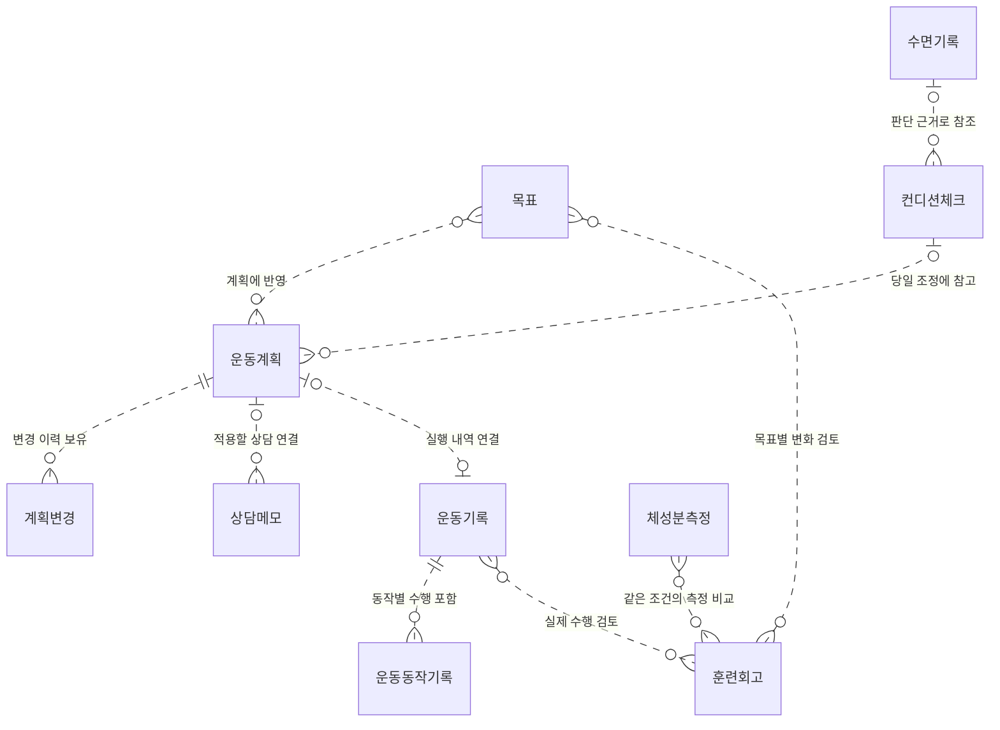

# AX YOUR BODY · 워크시트 문서

> 이 파일은 내 비공개 저장소 `axyourbody-worksheet`에 `worksheet.md`로 옮겨 씁니다(교재 부록 A-2). 강사 GitHub 아이디 `wild-mental`을 그 저장소에 초대합니다.

교재 [실습 안내]에 나온 워크시트 이름과 같은 제목을 아래에서 찾아 칸을 채웁니다. 표의 행은 필요한 만큼 늘립니다. 각 워크시트 끝의 **완료 기준 체크리스트**를 모두 채우면 그 워크시트는 완료입니다. 체크리스트는 점수가 아니라 스스로 점검하기 위한 것입니다.

## 기본 정보

이름:

담당 프로필 (한 명만 체크)

- [ ] 김도현 (남성 · 일반인) `m-general`
- [ ] 이서연 (여성 · 일반인) `f-general`
- [x] 박준혁 (남성 · 운동인) `m-athlete`
- [ ] 정하은 (여성 · 운동인) `f-athlete`

데이터 출처 (둘 다 썼다면 둘 다 체크)

- [x] 가상 프로필 데이터셋
- [ ] 내 실제 기록

Figma 파일 링크 (강사만 열람):

배포 링크 (GitHub Pages 공개 주소):

제출 (Day 4)

- [ ] 워크시트 저장소 링크: 이 저장소 (비공개 · 강사 `wild-mental`만 초대)
- [ ] Figma 파일 링크: 이벤트 보드 · 화면 흐름 순서표와 화면 목록 · 시안 비교표 (강사만 열람)
- [ ] 배포 링크: 최종 프로토타입의 GitHub Pages 주소 (공개, 배포 전 점검표를 마친 뒤)
- [ ] 나만의 DESIGN.md: `my-own-DESIGN.md`를 이 저장소에 올림

## 쓰는 법

- **고치기와 저장:** 이 파일을 열고 연필 아이콘(Edit)을 눌러 칸을 채운 뒤, **Commit changes**를 눌러 저장합니다.
- **표 확인:** 편집 화면의 **Preview** 탭으로 표가 제대로 보이는지 확인합니다.
- **체크 표시:** `- [ ]`의 칸 안에 `x`를 넣어 `- [x]`로 바꿉니다.
- **표 행 늘리기:** 빈 행 한 줄을 통째로 복사해 바로 아래 줄에 붙입니다. 맨 위 제목 줄과 `|---|` 줄은 건드리지 않습니다.
- **칸 안에 쓸 때:** `|` 기호는 쓰지 않습니다. 칸 안에서 줄을 바꾸지 않습니다. 한 칸에 여러 항목을 쓸 때는 쉼표(,)나 " · "로 나누거나 "1) 2)"처럼 번호를 붙입니다.
- **이미지:** **Add file → Upload files**로 저장소에 올린 뒤, 워크시트에 ``처럼 적어 연결합니다. 파일 이름은 영문 소문자로 씁니다.
- **Claude에 붙여 넣을 때:** 편집 화면의 글을 그대로 복사해 붙여 넣습니다.
- 클릭 순서는 교재 부록 A-2와 온라인 가이드 「GitHub 워크시트 저장소 가이드」를 봅니다.

Figma 템플릿에서 쓰는 워크시트는 이 문서에 없습니다(자료실의 Figma 템플릿 링크에서 내 계정으로 복제): 고객 여정 위에 사건과 대상 객체를 붙인 이벤트 보드 · 과업별 화면 흐름 순서표와 화면 목록 · Google Stitch로 만든 테마별 화면 시안 비교표.

## 차례

Part 1 · Day 1

1. [익숙한 서비스의 사용 경험을 과업 관점으로 뜯어본 사례 분석 시트](#익숙한-서비스의-사용-경험을-과업-관점으로-뜯어본-사례-분석-시트)
2. [타깃 사용자의 해야 할 일과 불편을 정리한 과업·불편 목록](#타깃-사용자의-해야-할-일과-불편을-정리한-과업불편-목록)
3. [설계 판단의 기준이 되는 타깃 사용자 페르소나 카드](#설계-판단의-기준이-되는-타깃-사용자-페르소나-카드)

Part 2 · Day 2

4. [서비스가 다루는 대상 객체·속성·관계를 정리한 대상 객체 카드](#서비스가-다루는-대상-객체속성관계를-정리한-대상-객체-카드)
5. [시스템 내부 용어와 사용자 용어를 맞춘 용어 대조표](#시스템-내부-용어와-사용자-용어를-맞춘-용어-대조표)
6. [메뉴·진입점·위치 표시를 정한 길찾기 진입점 선택표](#메뉴진입점위치-표시를-정한-길찾기-진입점-선택표)
7. [Claude에 넘길 서비스 구조 설명서](#claude에-넘길-서비스-구조-설명서)

Part 3 · Day 3

8. [참고할 AI 디자인 가이드(DESIGN.md) 후보 쇼핑 목록](#참고할-ai-디자인-가이드designmd-후보-쇼핑-목록)
9. [테마별로 만든 첫 프로토타입과 버전 기록](#테마별로-만든-첫-프로토타입과-버전-기록)

Part 4 · Day 4

10. [사용자 과업으로 시험한 사용성 테스트 기록표](#사용자-과업으로-시험한-사용성-테스트-기록표)
11. [나만의 디자인 가이드(DESIGN.md)와 점검표](#나만의-디자인-가이드designmd와-점검표)
12. [공개 전 개인정보·품질을 확인한 배포 전 점검표와 배포 링크](#공개-전-개인정보품질을-확인한-배포-전-점검표와-배포-링크)

---

## Part 1 · Day 1

### 익숙한 서비스의 사용 경험을 과업 관점으로 뜯어본 사례 분석 시트

교재: 1.2절 [실습 안내] · 온라인 가이드: 「사례 분석 시트 가이드」

| 칸 | 작성 |
|---|---|
| ① 분석한 서비스 | 플랜핏 (AI 헬스 루틴 추천 앱) |
| ② 사용자가 하려는 일 | 헬스장에 왔지만 어떤 기구부터 어떤 순서로 쓸지 몰라서, 내 운동 목적에 맞는 오늘의 운동 순서를 정하고 그대로 끝까지 마친다. |
| ③ 단계 | 1) 몇 가지 간단한 질문에 답해 운동 목적을 알린다 2) 목적에 맞게 제안된 루틴을 확인한다 3) 운동마다 애니메이션으로 기구 사용법을 본다 4) 운동 개수와 시간을 내 상황에 맞게 줄이거나 늘린다 5) 순서대로 운동하고 마친다 |
| ④ 막히는 지점 | 짐작: 추천 루틴의 기구가 내 헬스장에 없거나 누가 쓰고 있을 때, 같은 부위를 운동할 다른 기구로 바꾸는 방법을 그 자리에서 바로 찾기 어렵다. |
| ⑤ 잘 돕는 지점 | 1) 목적 조사가 짧은 질문 몇 개로 끝나고 바로 루틴이 나온다 2) 운동마다 사용법을 글 대신 애니메이션으로 보여준다 3) 운동 개수와 시간을 사용자가 조절할 수 있다 |
| ⑥ 관련 휴리스틱 | ④ 기구 바꾸기: 사용자 통제와 자유(3번) · 유연성과 효율성(7번) / ⑤ 애니메이션 사용법: 기억보다 인식(6번) · 시스템과 현실 세계의 일치(2번) |
| ⑦ AX YOUR BODY에 가져갈 교훈 | 1) 목적은 짧은 질문 몇 개로 묻고 곧바로 오늘 할 일을 순서대로 보여준다 2) 동작 설명은 글보다 보여주는 방식으로 한다 3) 양(개수·시간)은 사용자가 조절하게 하고, 계획대로 안 될 때 바꿀 길을 그 자리에 둔다 |

완료 기준 체크리스트

- [x] 하려는 일을 끝이 분명한 한 문장으로 썼다
- [x] 단계를 3~7개로 나눴다
- [x] 막히는 지점과 잘 돕는 지점을 각각 1개 이상 찾았다
- [x] 막히는 지점에 관련 휴리스틱을 붙였다
- [ ] 평가하는 말 대신 관찰한 사실로 썼다

점검 메모: ④는 기존 작성 내용의 짐작이며 실제 앱에서 재현한 관찰 기록이 아니다. 직접 확인하기 전까지 마지막 항목은 미체크로 둔다.

### 타깃 사용자의 해야 할 일과 불편을 정리한 과업·불편 목록

교재: 1.4절(머리칸), 1.5절(본표) [실습 안내] · 온라인 가이드: 「과업·불편 목록 가이드」

머리칸

| 칸 | 작성 |
|---|---|
| 선택한 프로필 | 박준혁 (남성 · 운동인) `m-athlete` |
| 데이터 출처 | 가상 프로필 데이터셋 |
| 고른 이유 | 나도 헬스장에서 어떤 운동을 어떤 순서로 할지 매번 고민해서, 코치 없는 날에도 코치처럼 판단해 주기라는 문장이 가장 와닿았다. 4주 기록을 열자 매주 하이록스 다음 날 하체 훈련이 이어지고 10/22 골격근량만 혼자 높다는 점이 바로 눈에 띄어, 판단을 도울 단서가 많은 프로필이라고 봤다. |

본표

| 번호 | 과업 (JTBD 문장) | 상황 | 하려는 일 | 불편 | 빈도 | 근거 | 기능 영역 | 우선순위 |
|---|---|---|---|---|---|---|---|---|
| 과업 1 | 하이록스를 한 다음 날 하체 훈련이 잡혀 있을 때, 오늘 무게와 양을 얼마나 할지 바로 정하고 싶다. 그래서 근력 목표와 하이록스 기록을 함께 지킨다. | 수요일 저녁 하이록스 다음 날 아침 6시 30분, 헬스장에서 하체 훈련 시작 전 | 오늘 하체 훈련의 무게·세트를 그대로 할지 줄일지 정한다 | 목표 셋(골격근·스쿼트 1RM·하이록스 기록)이 부딪칠 때 무엇을 우선할지 매번 혼자 계산한다 | 주 1회 (4주 동안 매주 수요일 하이록스 → 목요일 하체) | 카드 불편 ① · 카드 목표 우선순위 · workout.csv 2026-10-07 하이록스 스테이션 rpe 8 → 2026-10-08 프론트스쿼트 80.0kg rpe 8 · 2026-10-21 하이록스 스테이션 → 2026-10-22 힙스러스트 126.0kg rpe 9 | AI 코칭 · 목표 관리 | 상 |
| 과업 2 | 체성분을 잰 조건이 평소와 다를 때, 그 수치를 평소 기록과 나눠 보고 싶다. 그래서 골격근량이 정말 늘었는지 잘못 판단하지 않는다. | 훈련 직후 저녁처럼 아침 공복이 아닌 때 체성분을 잰 날 | 이번 측정값을 추세에 넣을지 뺄지 정하고 실제 변화를 확인한다 | 측정 조건이 매번 달라 수치 변화를 믿기 어렵다 | 측정 주 2회 (4주 8회) 중 비표준 측정 4주 1회 | 카드 불편 ③ · body.csv 2026-10-22 measure_condition 비표준(저녁 · 훈련 직후) skeletal_muscle_kg 37.0 weight_kg 82.9 · 같은 파일 2026-10-19 표준 36.5 · 2026-10-26 표준 36.5 | 기록 · 대시보드 | 상 |
| 과업 3 | 예전에 AI와 나눈 훈련·영양 상담을 다시 떠올려야 할 때, 그 내용을 한곳에서 바로 찾고 싶다. 그래서 같은 질문을 처음부터 다시 하지 않는다. | 셀프 훈련 날 루틴을 짜거나 식단을 고치다가 지난 상담 내용이 필요할 때 | 지난 상담의 결론을 찾아 오늘 판단에 쓴다 | AI와 나눈 상담이 대화창마다 흩어져 다시 찾을 수 없다 | 짐작: 주 2회 | 카드 불편 ② | AI 코칭 · 리서치 | 상 |
| 과업 4 | 주 1회 PT 다음의 셀프 훈련 날, 코치가 준 피드백을 그날 훈련에 이어 쓰고 싶다. 그래서 PT 없는 날에도 같은 기준으로 훈련한다. | PT를 받은 다음 날부터 다음 PT 전까지 혼자 훈련하는 아침 | 코치 피드백을 기준으로 오늘 종목·무게를 정한다 | 코치 피드백이 PT 시간에만 머물고 셀프 훈련 날에는 혼자 판단해야 한다 | 주 5회 (주 6일 훈련 중 PT 1회 제외) | 카드 PT 경험 · 예산 · 카드 원하는 한 문장 · 카드 운동 수준 (주 6일 훈련) | AI 코칭 · 기록 | 중 |
| 과업 5 | 잠을 적게 잔 날 고강도 훈련이 잡혀 있을 때, 오늘 강도를 그대로 할지 낮출지 알고 싶다. 그래서 무리해서 다음 훈련까지 망치지 않는다. | 수면이 6시간 남짓이었던 날 아침, 무거운 스쿼트·벤치 세션 전 | 수면·컨디션을 보고 오늘 강도를 정한다 | 수면과 컨디션 기록은 따로 있지만 훈련 강도 판단에 이어지지 않는다 | 4주 중 3일 (수면 6.1시간 이하) | sleep.csv 2026-10-12 sleep_hours 5.7 condition 3 · workout.csv 2026-10-12 백스쿼트 102.5kg rpe 9 · sleep.csv 2026-10-11 6.1 · 2026-10-13 6.0 | AI 코칭 · 기록 | 중 |
| 과업 6 | 회복 주간에 훈련량을 줄일 때, 줄인 이유와 어디까지 줄일지를 함께 남기고 싶다. 그래서 나중에 기록을 볼 때 부상이나 슬럼프로 착각하지 않는다. | 3주 동안 무게를 올린 뒤 4주차에 무게·시간을 크게 낮추는 주 | 웨이트와 하이록스를 모두 포함해 회복 주간 계획을 정하고 기록에 표시한다 | 무게만 줄어 있고 왜 줄였는지 기록에 남지 않는다 · 웨이트만 줄이고 하이록스는 평소대로 했다 | 짐작: 4주에 1회 | workout.csv 2026-10-19 백스쿼트 105.0kg rpe 9 → 2026-10-26 백스쿼트 60.0kg rpe 6 minutes 50 · workout.csv 2026-10-28 하이록스 스테이션 minutes 70 rpe 8 | 기록 · 목표 관리 | 중 |
| 과업 7 | 한 달 훈련을 돌아볼 때, 골격근량과 스쿼트 1RM 목표까지 얼마나 남았는지 알고 싶다. 그래서 다음 달 계획을 고칠지 정한다. | 4주 훈련 사이클을 마친 주말 | 목표별 현재 위치와 남은 양을 확인한다 | 1RM을 따로 재지 않아 현재 값을 모르고, 골격근량 변화는 작아 늘었는지 체감하기 어렵다 | 짐작: 4주에 1회 | 카드 목표 ① ② · body.csv 2026-10-05 skeletal_muscle_kg 36.3 → 2026-10-29 36.6 · workout.csv 2026-10-19 백스쿼트 105.0kg 5회 5세트 rpe 9 | 대시보드 · 목표 관리 | 중 |

- JTBD 문장 형식: 「~할 때, ~하고 싶다. 그래서 ~.」
- 기능 영역: 기록 · AI 코칭 · 목표 관리 · 대시보드 · 리서치 가운데 고릅니다(여러 개 가능).

완료 기준 체크리스트

- [x] 머리칸 세 칸(선택한 프로필·데이터 출처·고른 이유)을 채웠다
- [x] 과업을 5~7개 남겼다 (번호는 과업 1, 과업 2 …)
- [x] 모든 과업에 근거를 적었다 (카드 항목, CSV 파일·날짜·값, 인터뷰. 없으면 "추측")
- [x] 빈도를 "매일", "주 2회"처럼 구체적으로 적고, 짐작이면 "짐작:"을 붙였다
- [x] 우선순위 "상"은 3개 이하다
- [ ] Claude가 제안한 과업은 근거 칸을 내가 직접 확인한 출처로 썼다

점검 메모: AI가 로컬 교재 저장소의 프로필 카드와 CSV를 대조했다. 학습자 본인의 원본 확인 여부는 대신 확인할 수 없으므로 마지막 항목은 직접 검토 후 체크한다. 과업 6의 회복 주간이라는 해석과 감량 이유를 남기려는 필요는 짐작이며, CSV에서 확인되는 사실은 웨이트 중량·시간 감소와 10/28 하이록스 70분·RPE 8 기록이다.

### 설계 판단의 기준이 되는 타깃 사용자 페르소나 카드

교재: 1.6절 [실습 안내] · 온라인 가이드: 「페르소나 카드 가이드」

카드 제목: 페르소나 카드 초안 · 박준혁 (`m-athlete`)

작성 근거: 교재 자료 저장소 `ax-wave-uxui-wildmental`의 `textbook-materials/profile-cards.md` 「프로필 3」 및 `datasets/m-athlete/`의 `body.csv`, `workout.csv`, `sleep.csv`. 아래 수치는 모두 가상 데이터이며, 설계 판단·짐작·가상 발언은 실제 기록과 구분한다.

| 칸 | 작성 내용 |
|---|---|
| 한 줄 정체성 | 설계 관점의 요약: 웨이트와 하이록스를 병행하며, 코치 없는 날에도 목표 우선순위와 기록을 근거로 오늘 훈련의 무게·양을 정하려는 운동인. |
| 근거 사실 | ① 웨이트 8년·하이록스 2년, 주 6일 훈련하며 주 1회 PT 외에는 셀프 훈련한다 (프로필 카드 운동 수준·경력, PT 경험·예산) ② 목표 충돌 때의 판단, 흩어진 AI 상담, 체성분 측정 조건 차이가 불편이다 (프로필 카드 현재 불편 ①~③) ③ 10/21 하이록스 55분·RPE 7 다음 날 10/22 프론트스쿼트 84kg·4회·4세트·RPE 8.5와 힙스러스트 126kg·RPE 9를 기록했다 (workout.csv 2026-10-21~22) ④ 10/22 저녁·훈련 직후 골격근량은 37.0kg이고, 아침 공복인 10/19·10/26은 모두 36.5kg이다 (body.csv 해당 날짜) |
| 하루 장면 | 기록: 2026-10-22는 전날 하이록스에 이어 하체 웨이트를 했고 저녁 훈련 직후 비표준 조건으로 체성분을 쟀다 (workout.csv 2026-10-21~22, body.csv 2026-10-22). 짐작: 평소 일과의 06:30 훈련 시작 전, 오늘 무게·세트를 유지할지 고민하고 지난 상담을 찾아본다 (프로필 카드 하루 일과·현재 불편을 조합한 장면이며 당일 행동 관찰은 아님). |
| 목표 우선순위 | ① 골격근량 36.2kg → 37.5kg ② 백스쿼트 1RM 115kg → 125kg ③ 하이록스 기록 유지, 다른 목표를 방해하지 않기 (프로필 카드 목표 순서 그대로). 카드의 출발값과 CSV 측정값은 구분하며, 훈련 중량을 실측 1RM으로 간주하지 않는다. |
| 핵심 과업 | 과업 1: 하이록스 다음 날 하체 훈련의 무게·세트를 유지할지 줄일지 정한다 · 과업 2: 체성분 측정 조건을 구분하고 이번 수치를 추세에 포함할지 판단한다 · 과업 3: 지난 훈련·영양 상담의 결론을 찾아 오늘 판단에 쓴다 (과업·불편 목록 우선순위 상 3개). |
| 이 사람이라면 이렇게 말할 것 | 짐작·가상 발언(실제 인터뷰 아님): "어제 하이록스를 했는데 오늘 하체는 원래 무게로 해도 될까?" · "운동 끝나고 잰 근육량도 아침 기록이랑 같이 봐도 돼?" · "지난번에 상담했던 결론만 다시 보고 싶어." → Day 2 용어 대조표 재료: 오늘 하체, 무게, 운동량, 측정 조건, 아침 기록, 지난 상담, 상담 결론. |
| 설계 원칙 | 설계 판단: ① 이 사람을 위해 우리는 오늘 훈련을 결정할 때 목표 순서와 전날 훈련·수면 등 판단 근거를 함께 보여준다 (과업 1·5) ② 측정 조건이 다른 체성분값을 같은 조건의 변화처럼 해석하지 않게 하고, 추세 포함 여부는 사용자가 정하게 한다 (과업 2) ③ 지난 상담의 결론과 당시 맥락·날짜를 함께 찾아 오늘에도 적용할지 판단하게 한다 (과업 3). |
| 피해야 할 가정 | ① "운동 8년 차면 코치 없이도 모든 강도를 결정할 수 있다"고 가정하지 않는다: 카드에 목표 충돌 때 혼자 계산하는 불편과 코치 같은 판단 지원의 필요가 명시돼 있다 (프로필 카드 현재 불편 ①·원하는 한 문장) ② "골격근량 37.0kg이면 실제 근육이 늘었다"고 단정하지 않는다: 해당 측정은 비표준 조건이며 전후 표준 측정은 36.5kg이다 (body.csv 2026-10-19·22·26) ③ "스쿼트 105kg 5회가 현재 1RM이다"라고 가정하지 않는다: 5회 5세트 훈련 기록이며 1RM 측정이 아니다 (workout.csv 2026-10-19). |

완료 기준 체크리스트

- [x] 여덟 칸을 모두 채웠다
- [x] 근거 사실과 내 판단을 구분했다
- [x] 근거를 확인할 수 없는 문장은 지우거나 "짐작"으로 표시했다
- [x] 핵심 과업이 과업·불편 목록의 우선순위 "상" 과업 번호와 이어진다
- [x] "이 사람이라면 이렇게 말할 것"을 용어 대조표의 재료로 표시했다
- [x] 피해야 할 가정을 1개 이상 적었다

---

## Part 2 · Day 2

이 날 Figma 템플릿에서 쓰는 워크시트: 고객 여정 위에 사건과 대상 객체를 붙인 이벤트 보드 (2.2절, 2.4절)

### 서비스가 다루는 대상 객체·속성·관계를 정리한 대상 객체 카드

교재: 2.5절 [실습 안내] · 온라인 가이드: 「대상 객체 카드 작성 가이드」

대상 객체 후보에 대한 개념 위계 정리 · 박준혁 (`m-athlete`) 초안

판단 기준: `peer-review-guide.md`의 「대상객체 후보에 대한 개념 위계 정리」와 대화 2, `object-card-guide.md`의 “쌓이는가 · 따로 고치는가 · 따로 찾는가”를 적용했다. 아래는 사용자 검토를 위한 설계안이며, 실제 짝 리뷰를 마쳤다는 뜻은 아니다. 기존 7개 장면과 E01~E14는 서비스 사건 가설이다. Day 2 잔여 작성에서 과업 3을 지원하기 위해 상담메모를 보완했고, 수면 입력·상담 저장·적용을 E15~E17 추가 사건 후보로 구분했다. 실제 짝 대화는 미실시이며 서비스 구조 설명서는 문서 간 정합성을 확인한 검토 전 초안으로 작성했다.

```text
AX YOUR BODY · 코치 없는 날에도 근거를 보고 오늘 훈련을 결정하기
├─ 기준 [분류]
│  └─ 목표 [엔티티]
│     └─ 목표 지표 · 목표값 · 우선순위 · 목표 기간 [값]
├─ 계획 [분류]
│  ├─ 운동계획 [엔티티 · 이번 범위]
│  │  ├─ 예정 시각 · 가용 시간 · 예정 운동 · 처리 상태 · 반복 규칙 [값]
│  │  └─ 계획변경 [연결 엔티티 · 변경 시각/이유/전후 내용]
│  ├─ 수면계획 [확장 후보 · 현재는 수면 기록만 사용]
│  ├─ 휴식계획 [확장 후보 · 쉬는 선택은 운동계획에도 반영]
│  └─ 식단계획 [확장 후보 · 영양 계획 장면을 검증한 뒤 판단]
├─ 기록 [분류]
│  ├─ 운동기록 [엔티티]
│  │  ├─ 실행 여부 · 운동 종류 · 수행 시간 · 레슨 여부 · 코칭 메모 [값]
│  │  └─ 운동동작기록 [연결 엔티티 · 동작별 수행]
│  │     └─ 동작 · 세트 수 · 반복 수 · 중량 · RPE · 부위 [값]
│  ├─ 수면기록 [엔티티 · 시작/종료 시각/주관적 만족도]
│  ├─ 체성분측정 [엔티티 · 측정 조건/체중/골격근량/체지방률]
│  ├─ 컨디션체크 [엔티티 · 오늘 계획 판단에 쓰는 자기 보고]
│  │  └─ 피로 · 스트레스 · 통증(부위/정도/발생 시점) [값]
│  ├─ 상담메모 [엔티티 · 상담일시/주제/상대/질문/답변/결론]
│  ├─ 휴식기록 [확장 후보 · 별도 기간을 쌓고 찾는 필요 확인]
│  └─ 식사기록 [확장 후보 · 식사 시각/탄수화물/단백질/지방]
└─ 돌아보기 [분류]
   └─ 훈련회고 [엔티티 · 기간별 판단/다음 행동]
      └─ 목표·운동기록·체성분측정을 참조
```

- **분류와 관계의 차이:** 위 들여쓰기는 개념을 정리한 것이며 데이터의 소유 관계나 메뉴 구조를 확정하지 않는다. 실제 연결과 개수는 아래 관계 표·ERD로 정의한다. 각 엔티티는 식별자로 추적한다.
- **PT 세션·트레이너:** 별도 예약·결제·트레이너 관리 객체는 이번 범위에서 제외한다. PT에서 운동한 사실은 운동기록의 레슨 여부와 코칭 메모로 남긴다. 코치가 한 조언을 사용자가 자기 훈련에 참고하는 범위다.
- **실행 여부·공백:** 운동기록의 실행 여부는 사용자가 확인한 사실이다. 운동기록이 없다고 미실행으로 단정하지 않는다. 계획의 처리 상태는 예정·완료·취소·미실행·미확인으로 구분하며, 반복 규칙과 실제 수행도 분리한다.
- **회복과 휴식:** 회복 목적 운동은 운동 종류의 값이고, 운동을 쉬는 것은 계획의 선택이다. 휴식 기간 자체를 따로 수정·검색할 필요가 확인되면 휴식계획·휴식기록을 독립시킨다.
- **컨디션과 통증:** 컨디션은 수면·통증을 모두 복사한 종합 점수가 아니다. 오늘 훈련을 결정하는 시점의 자기 보고를 저장하고 수면기록을 참조한다. 통증 개선도는 계산값이므로 속성에 넣지 않는다. 통증을 독립 추적하거나 여러 부위·경과를 관리해야 한다면 통증기록 분리를 재검토한다.
- **지난 상담 보완:** 과업 3의 우선순위는 상이지만 기존 9개 객체에는 상담 내용을 별도로 찾을 구조가 없었다. 상담메모를 10번째 객체로 추가한다. AI와 코치의 말을 상담 상대 값으로 구분하고, 코칭 메모에서 따로 다시 찾을 내용은 사용자가 상담메모로 저장한다. 영양 상담 저장은 식단계획 서비스를 추가한다는 뜻이 아니다.
- **근거와 확장:** 수면·체성분·운동은 가상 CSV와 기존 장면에 근거가 있다. 수면 시작/종료 시각·스트레스·통증 등은 새 입력 설계안이며 CSV에 있는 사실이 아니다. 식사 데이터가 있다는 이유만으로 식단 서비스를 이번 범위에 추가하지 않는다.

이벤트 보드 후보의 처리

| 기존 후보 | 이번 정리 | 판단 이유 |
|---|---|---|
| 훈련계획 · 일정 · 준비물 | 운동계획, 예정 시각·가용 시간·예정 운동의 준비물 값 | 운동관리 범위를 이름에 드러내며 별도 일정·재고 서비스는 만들지 않는다 |
| 체성분측정 | 독립 엔티티 유지 | 날짜별로 쌓이고 측정 조건을 고치거나 과거 값을 찾는다 |
| 컨디션기록 | 컨디션체크로 구체화 | 오늘 계획의 판단에 연결되는 자기 보고이며 막연한 상태 대시보드가 아니다 |
| 목표 | 독립 엔티티 유지 | 지표별 목표값·우선순위·기간을 따로 바꾼다 |
| 운동세션 · 세트기록 | 운동기록 · 운동동작기록으로 정리 | CSV는 동작별 중량·반복 수·세트 수를 기록한다. 개별 세트 수행값이 없는 자료를 세트마다 관찰한 값처럼 만들지 않는다 |
| 계획변경 | 독립 엔티티 유지 | 이유와 변경 전후가 여러 번 쌓이며, 언제 무엇을 바꿨는지 따로 되짚는다 |
| 지난 AI 상담 (과업 3 보완) | 상담메모 추가 | 주제·상대·날짜로 따로 찾고 결론을 오늘 계획에 연결해야 하며 코치 피드백과 작성 출처를 구분한다 |
| 목표평가 | 훈련회고로 구체화 | 자동 계산된 달성률과 사용자가 남긴 해석을 구분한다. 계산값은 저장 속성에서 빼고 판단·다음 행동을 남긴다 |

| 대상 객체 | 한 줄 설명 | 핵심 속성 (필수 / 선택) | 엔티티·값 메모 | 관계 | 관련 사건 |
|---|---|---|---|---|---|
| 목표 | 이번 훈련 구간에서 발전·유지하려는 기준 | 필수: 지표 · 목표값 · 우선순위 · 목표 기간 / 선택: 기준값 · 유지/향상 구분 | 식별자로 추적하는 엔티티, 골격근량·백스쿼트 1RM·하이록스 완주 시간은 지표 값, 달성률은 계산값 | 목표 N:M 운동계획 · 목표 N:M 훈련회고 | E07 오늘의 중점 목표가 선택됨 · E13 목표별 변화가 검토됨 · E14 다음 구간의 중점이 정해짐 |
| 운동계획 | 특정 날짜에 하려는 한 번의 운동 | 필수: 예정 시각 · 가용 시간 · 예정 운동 · 처리 상태 / 선택: 반복 규칙 | 식별자로 추적하는 엔티티, 예정 운동은 동작·목표 무게/횟수/세트·준비물을 담는 값 목록, 반복 규칙은 향후 계획 생성용 값 | 운동계획 N:M 목표 · 운동계획 0..1:0..1 운동기록 · 운동계획 1:N 계획변경 · 운동계획 N:0..1 컨디션체크 · 운동계획 0..1:N 상담메모 | E01 가용 시간이 등록됨 · E02 내일 훈련계획이 확정됨 · E08 훈련계획이 조정됨 |
| 계획변경 | 한 운동계획을 바꾼 이유와 전후 내용 | 필수: 변경 시각 · 변경 이유 · 변경 전 내용 · 변경 후 내용 | 식별자로 추적하는 엔티티, 시간 부족·장비 제약·몸 상태는 이유 값, 대안 실행·중단은 변경 후 선택 값 | 계획변경 N:1 운동계획 | E06 계획 재검토 사유가 남겨짐 · E11 계획 변경 사유가 기록됨 · E12 대안 또는 중단이 선택됨 |
| 운동기록 | 개인이 실제로 운동했거나 하지 않았다고 확인한 내역 | 필수: 날짜/시각 · 운동 종류 · 실행 여부 / 선택: 수행 시간 · 레슨 여부 · 코칭 메모 | 식별자로 추적하는 엔티티, 회복·웨이트·유산소·교정·가동성은 종류 값 후보, 실제 운동하지 않은 날도 명시적으로 남길 수 있음 | 운동기록 0..1:0..1 운동계획 · 운동기록 1:N 운동동작기록 · 운동기록 N:M 훈련회고 | E09 운동세션이 시작됨 · E10 세트 수행값이 기록됨 |
| 운동동작기록 | 한 운동 안에서 한 동작을 얼마나 수행했는지 남긴 내역 | 필수: 동작명 · 세트 수 · 반복 수 / 선택: 중량 · RPE · 부위 | 식별자로 추적하는 엔티티, 동작명·부위는 값, 세트 수는 사용자가 입력한 요약값, 원본 CSV도 이 단위이며 개별 세트가 모두 같았다는 관찰을 뜻하지 않음 | 운동동작기록 N:1 운동기록 | E10 세트 수행값이 기록됨, 향후 사건 이름은 동작 수행이 기록됨으로 구체화 검토 |
| 상담메모 | 다시 찾거나 오늘 운동에 참고할 상담 내용 | 필수: 상담일시 · 주제 · 상담 상대 · 질문 · 답변 / 선택: 결론 | 식별자로 추적하는 엔티티, 상담 상대는 AI/코치 등 출처 값, 질문·답변은 원문이며 결론은 요약 여부와 작성 주체를 함께 표시하는 값, 새 입력안으로 원본 CSV에 상담 내용은 없음 | 상담메모 N:0..1 운동계획 | 추가 후보 E16 상담 내용이 저장됨 · E17 상담메모가 운동계획에 연결됨 |
| 수면기록 | 한 번의 수면을 나중에 훈련 판단에 참조할 기록 | 필수: 수면일 · 수면 시간 / 선택: 수면 시작 시각 · 수면 종료 시각 · 주관적 만족도 | 식별자로 추적하는 엔티티, CSV의 sleep_hours는 직접 입력한 수면 시간으로 보존, 시작·종료 시각은 향후 입력안이며 둘 다 입력하면 시간은 계산해 중복 수정하지 않음 | 수면기록 0..1:N 컨디션체크 | E05 오늘 컨디션이 기록됨에서 참조, 추가 사건 후보: 수면 내역이 기록됨 |
| 컨디션체크 | 오늘 계획을 판단할 때 남긴 자기 보고 | 필수: 체크 시각 · 주관적 컨디션 / 선택: 피로 · 스트레스 · 통증 | 식별자로 추적하는 엔티티, 통증은 부위·정도·발생 시점의 값 묶음, 주관적 컨디션과 측정 수면을 같은 점수로 합치지 않음 | 컨디션체크 N:0..1 수면기록 · 컨디션체크 0..1:N 운동계획 | E05 오늘 컨디션이 기록됨 · E06 계획 재검토 사유가 남겨짐 |
| 체성분측정 | 측정 조건을 포함한 한 번의 체성분 측정 | 필수: 측정일시 · 측정 조건 · 체중 · 골격근량 / 선택: 체지방률 · 추세 포함 여부 | 식별자로 추적하는 엔티티, 표준/비표준·공복/훈련 직후는 조건 값, 변화량은 계산값, 추세 포함 여부는 원값 삭제와 다름 | 체성분측정 N:M 훈련회고 | E03 체성분 측정값과 조건이 기록됨 · E04 추세 비교 대상이 선택됨 |
| 훈련회고 | 한 구간의 변화에 대한 사용자 판단과 다음 행동 | 필수: 회고일 · 평가 기간 · 판단 메모 · 다음 행동 | 식별자로 추적하는 엔티티, 목표·운동·측정을 연결해 해석하며 목표 달성률이나 추정 1RM을 입력 속성으로 저장하지 않음 | 훈련회고 N:M 목표 · 훈련회고 N:M 운동기록 · 훈련회고 N:M 체성분측정 | E13 목표별 변화가 검토됨 · E14 다음 구간의 중점이 정해짐 |

관계 표기: `1:N`의 N쪽은 0건일 수도 있다. `N:0..1`은 왼쪽 여러 건이 오른쪽 없거나 하나에 연결되는 선택 관계다. 계획 없이 한 운동기록과 실행되지 않은 운동계획을 모두 허용하므로 계획·기록 연결은 `0..1:0..1`이다. 한 계획을 여러 번 실행하려면 계획을 새로 만든다. 사용자별 소유 관계는 단일 사용자 서비스의 공통 전제로 생략했다. N:M의 연결 테이블은 구현 때 정한다.

개념 ERD (Mermaid · 상자는 엔티티, 선은 데이터 관계이며 화면 이동이 아님)



차트 표기: `||`는 정확히 하나, `o|` 또는 `|o`는 0~1개, `o{` 또는 `}o`는 0개 이상이다. 점선은 상대 객체의 식별자가 자신의 식별자를 구성하지 않는 비식별 관계를 뜻한다. GitHub 또는 Mermaid를 지원하는 Markdown 미리 보기에서 차트로 표시된다.

Claude 리뷰와 고친 이유

※ 템플릿의 리뷰 메모 제목을 유지했다. 이번 검토는 Codex가 가이드를 적용한 작성안이며, Claude 실행 또는 실제 동료와의 대화를 수행했다는 기록이 아니다. 아래 결정은 사용자 검토 전의 설계 결정안이다.

- “모든 명사를 독립 객체로 만들 수 있다” → 고침: 일정·준비물·레슨 여부·통증을 각각 관련 객체의 속성/값으로 정리 → 이번 서비스에서 별도로 쌓고 고치고 찾을 필요가 확인되지 않았다.
- “컨디션은 모두 계산해서 표시하는 값이다” → 유지: 컨디션체크를 별도 엔티티로 둠 → 주관적 자기 보고는 수면 시간으로 계산할 수 없고, 당시 계획을 바꾼 이유를 찾는 근거가 된다. 종합 컨디션 점수와 진단 기능은 만들지 않는다.
- “계획변경은 운동계획의 메모로 충분하다” → 유지: 연결 엔티티로 둠 → 반복 변경의 시각·이유·전후 내용을 순서대로 찾고 비교해야 하므로 현재값 하나로 덮어쓰지 않는다.
- “세트기록이 있으니 CSV를 세트별로 펼치면 된다” → 고침: 운동동작기록의 세트 수·반복 수로 보존 → 원본은 동작 단위 요약이며 세트마다의 중량·RPE를 직접 관찰한 자료가 아니다.

후속 검증: 짝에게 컨디션체크의 독립 효용, 계획변경 이력의 필요, 운동동작기록 이름을 설명하고 질문을 받는다. Figma의 기존 후보 이름·E10·수면 사건과 이 초안의 차이는 후속 보드 정리 항목으로 남긴다. 용어 대조표·진입점 선택표·서비스 구조 설명서를 아래에 작성했다. 실제 동료 대화는 아직 하지 않았으므로 설명서는 검토 전 초안이며, 대화에서 바뀐 객체·이름·사건을 먼저 고친 뒤 설명서를 갱신한다.

완료 기준 체크리스트

- [x] 이벤트 보드에서 발견된 대상 객체들을 이 템플릿 표에 모두 옮겼다 (한 행으로, 또는 다른 행의 속성으로)
- [x] 대상 객체마다 핵심 속성을 3~6개 적었다 (계산되는 값은 뺐다)
- [x] 관계에 1:1 / 1:N / N:M을 표시했다
- [x] 엔티티와 값을 구분했다
- [x] 개념 ERD를 그렸다

### 시스템 내부 용어와 사용자 용어를 맞춘 용어 대조표

교재: 2.6절 [실습 안내], 2.9절(리뷰 메모) · 온라인 가이드: 「용어 대조표 작성 가이드」, 「동료 리뷰 진행 가이드」

라벨링 기준 · 토스 공식 UX 라이팅 자료 참고 (2026-11-25)

- [토스의 8가지 라이팅 원칙들](https://toss.tech/article/8-writing-principles-of-toss): 한 번에 이해되는 말, 다음 화면을 예상할 수 있는 표현, 일상에서 말하기 쉬운 표현을 기준으로 삼았다.
- [토스플레이스 UX 라이팅 가이드](https://docs.tossplace.com/guide/front-integration/plugin/design/ux-writing.html): 읽는 사람과 상황을 먼저 정하고, 능동형 문장·명사 덩어리 풀기·구체적인 버튼·같은 대상의 이름 통일을 참고했다. POS 전용 세부 규칙을 우리 서비스 전체에 그대로 적용한 것은 아니다.
- 우리 서비스 적용안: 박준혁이 운동 전·중에 빠르게 읽는 상황을 기준으로 한다. 제목·필드 이름은 짧은 명사로, 질문·안내는 해요체로, 버튼은 대상과 행동을 함께 쓴다. 행위자가 판단에 영향을 주면 사용자·AI·코치를 구분한다. 단순히 글자 수를 줄이기 위해 무게·횟수·측정 조건 같은 의미를 지우지 않는다.
- 내부 객체 이름과 ERD는 유지하고 화면에 표시할 말만 아래처럼 대응한다. 아래 추천은 AI의 문구 검토안이며 실제 사용자의 이해도나 동료 리뷰 결과가 아니다. 리뷰 메모에는 AI가 예상한 오해와 추천 결정을 적고, 실제 짝 리뷰가 아니라는 점을 표시한다.

| 시스템 내부 용어 | 사용자 용어 (화면에 쓸 말) | 쓰는 맥락 · 뜻 차이 | 피할 말 | 근거 | 리뷰 메모 |
|---|---|---|---|---|---|
| 목표 | 운동 목표 | 목표 목록·상세 제목, 골격근량·스쿼트·하이록스의 목표를 보여줌, 현재 달성값은 목표값과 구분 | 목표 관리 · 성과 · 목표평가 | 페르소나 목표 우선순위, 대상 객체 목표, 토스 명확성 원칙 | AI 검토: 운동 이외의 목표로 읽힐 수 있음 → 추천: 운동 목표, 실제 짝 리뷰 전 |
| 운동계획 | 운동 계획 / 오늘 운동 계획 (오늘 상세) | 앞으로 하려는 운동, 날짜가 오늘일 때만 오늘을 붙임, 이미 한 운동과 구분 | 처방 · 루틴 (계획 전체의 동의어) · 오늘의 추천 | 장면 1·4, 대상 객체 운동계획, 다음 내용을 예상할 수 있는 이름 | AI 검토: 실제로 한 운동과 섞일 수 있음 → 추천: 운동 계획 / 오늘 운동 계획 (오늘 상세), 실제 짝 리뷰 전 |
| 계획변경 | 운동 계획 변경 내역 | 언제 무엇을 왜 바꿨는지 보는 곳, 아직 적용하지 않은 AI 제안은 포함하지 않음 | 계획변경 · 변경 사항 · 조정 결과 | 장면 6, 대상 객체 계획변경, 무엇이 바뀌었는지 명시 | AI 검토: 무엇을 바꾼 내역인지 빠져 있음 → 추천: 운동 계획 변경 내역, 실제 짝 리뷰 전 |
| 운동기록 | 운동 일지 | 날짜별 실제 운동과 사용자가 직접 남긴 미실행 내역, 최고 중량·대회 완주 기록과 구분 | 기록 · 운동기록 (최고 기록과 혼용) · 운동세션 | 장면 5·7, 대상 객체 운동기록, 동료 리뷰 가이드의 기록 중의성 | AI 검토: 최고 중량·완주 시간을 뜻하는 기록과 혼동 가능 → 추천: 운동 일지, 실제 짝 리뷰 전 |
| 운동동작기록 | 종목별 운동 내역 / 무게·횟수·세트 (웨이트 상세 항목) | 운동 일지 안에서 종목별 수행 내용을 보여줌, 백스쿼트 등 종목명이 바로 위에 있을 때 상세 제목을 줄임, 전체 운동 일지와 구분 | 운동동작기록 · 세트기록 (세트별 값이 없는 경우) · 볼륨 | CSV의 동작별 요약 구조, 대상 객체 운동동작기록, 명사 덩어리와 중의성 검토 | AI 검토: 내부 데이터 이름이며 종목별 상세인지 불분명 → 추천: 종목별 운동 내역 / 무게·횟수·세트 (웨이트 상세 항목), 실제 짝 리뷰 전 |
| 상담메모 | 지난 상담 | 주제·날짜·상담 상대별로 다시 찾는 내용, 답변과 결론을 구분하며 결론의 작성 주체·요약 여부를 표시, 상담을 시작하는 행동과 구분 | 상담 관리 · AI 기억 · 코칭 결과 | 과업 3·프로필 불편 ②, 반복 조회와 발언 출처 구분 | AI 검토: 지난 상담 찾기와 새 상담을 구분해야 함 → 추천: 지난 상담, 실제 짝 리뷰 전 |
| 수면기록 | 수면 기록 | 잔 시간과 수면 시각·주관적 평가, 취침 계획과 실제 수면을 구분 | 회복 점수 · 수면 분석 (분석 없이 기록만 보일 때) | 장면 3, sleep.csv, 대상이 붙으면 뜻이 분명하므로 기록이라는 단어를 일괄 금지하지 않음 | AI 검토: 수면이라는 대상이 있어 뜻이 분명함 → 추천: 수면 기록, 실제 짝 리뷰 전 |
| 컨디션체크 | 오늘 몸 상태 | 피로·통증·주관적 컨디션을 직접 남기는 곳, 자동 계산된 진단이나 운동 가능 판정이 아님, 스트레스 질문은 별도 항목으로 표시 | 컨디션체크 · 상태 · 준비도 · 회복 진단 | 장면 3, 자기 보고와 자동 판단 구분, 사용자에게 익숙한 표현 | AI 검토: 무엇을 누가 체크하는지 불분명 → 추천: 오늘 몸 상태, 실제 짝 리뷰 전 |
| 체성분측정 | 체성분 기록 | 목록·상세에서 날짜·측정 조건·수치를 함께 보여주는 저장 내역, 과거 기록을 찾고 변화를 비교하는 맥락, 체성분 측정값은 그 기록 안의 체중·골격근량 등 숫자를 가리킬 때 사용 | 체성분 측정값 (목록 전체의 이름으로 사용) · 인바디 (다른 기기 포함 시) · 몸 상태 (체성분만 보일 때) | 장면 2, body.csv, 날짜별로 쌓이는 객체의 범위와 사용자의 과거 기록 찾기에 맞춰 재검토 | AI 검토: 측정 행동과 저장 내역이 섞임 → 추천: 체성분 기록, 실제 짝 리뷰 전 |
| 훈련회고 | 내 운동 돌아보기 | 선택한 기간의 운동·측정값을 보고 내가 판단과 다음 행동을 남김, AI 자동 요약은 작성 주체를 따로 표시 | 훈련회고 · 리포트 · 운동 분석 (내 메모인 경우) | 장면 7, 대상 객체 훈련회고, 일상 말과 작성 주체 명시 | AI 검토: 자동 분석인지 직접 쓴 판단인지 불분명 → 추천: 내 운동 돌아보기, 실제 짝 리뷰 전 |
| 가용 시간 | 운동할 수 있는 시간 | 오늘 일정에서 운동에 쓸 수 있는 시간 입력, 실제 운동 시간과 구분, 예: 45분 | 가용 시간 · 잔여 시간 · 운동 시간 (계획/실제 혼용) | 장면 1, 운동계획 속성, 일상 말로 풀기 | AI 검토: 행동·수치·출처를 맥락에 맞춰 구분할 필요 → 추천: 운동할 수 있는 시간, 실제 짝 리뷰 전 |
| 수행 시간 | 실제 운동 시간 | 운동 일지의 실제 수행 시간, 계획에서 확보한 시간과 구분, 예: 38분 | 소요 시간 (대상 생략) · 가용 시간 | 운동기록 속성, 계획과 실행의 뜻 차이 | AI 검토: 행동·수치·출처를 맥락에 맞춰 구분할 필요 → 추천: 실제 운동 시간, 실제 짝 리뷰 전 |
| 예정 운동 · 동작명 | 할 운동 (계획) / 운동 종목 (입력 항목) | 계획에는 앞으로 할 운동을 표시, 종목 선택 항목에는 백스쿼트·벤치프레스 등 실제 종목명을 표시 | 대상 동작 · 운동 객체 · 종목명 입력 수행 | 운동계획·운동동작기록 속성, 계획과 실제 수행 구분 | AI 검토: 행동·수치·출처를 맥락에 맞춰 구분할 필요 → 추천: 할 운동 (계획) / 운동 종목 (입력 항목), 실제 짝 리뷰 전 |
| RPE | 체감 운동 강도(RPE) | 사용자가 느낀 강도를 입력, 무게나 세트 수 자체와 구분, 입력 도움말: 운동이 얼마나 힘들었나요? 1~10으로 남겨주세요. | 운동 점수 · 컨디션 점수 · RPE (첫 노출 단독 표기) | workout.csv rpe, 숙련자의 전문 용어를 유지하면서 뜻을 함께 설명 | AI 검토: 행동·수치·출처를 맥락에 맞춰 구분할 필요 → 추천: 체감 운동 강도(RPE), 실제 짝 리뷰 전 |
| 측정 조건 | 측정한 때의 상태 | 항목 예: 아침 공복 · 저녁 · 운동 직후, 입력 질문: 언제, 어떤 상태에서 측정했나요? | 표준 · 비표준 (이유 없이 단독 노출) · 정상 · 이상 | 장면 2, measure_condition, 측정 조건 차이를 신체 이상으로 오해하지 않게 함 | AI 검토: 행동·수치·출처를 맥락에 맞춰 구분할 필요 → 추천: 측정한 때의 상태, 실제 짝 리뷰 전 |
| 추세 포함 여부 | 변화 그래프에 포함하기 | 그래프에서 비교 대상으로 사용할지 선택, 제외해도 원본 측정값은 보존, 도움말: 꺼도 측정값은 남아 있어요. | 이상치 제거 · 기록 삭제 · 정상값만 보기 | 장면 2, 원본 보존과 비교 선택의 차이, 행동의 실제 결과 명시 | AI 검토: 행동·수치·출처를 맥락에 맞춰 구분할 필요 → 추천: 변화 그래프에 포함하기, 실제 짝 리뷰 전 |
| 레슨 여부 · 코칭 메모 | PT를 받은 날인가요? / 코치에게 들은 말 | 운동 일지의 직접 입력 질문과 메모 제목, 레슨은 PT로 한정한 현재 범위의 표현, 코치 발언과 AI 문구를 섞지 않음 | 레슨 여부 · 코칭 결과 · 전문가 진단 | 프로필 PT 경험, 운동기록 속성, 응답 대상과 발언 출처 명시 | AI 검토: 행동·수치·출처를 맥락에 맞춰 구분할 필요 → 추천: PT를 받은 날인가요? / 코치에게 들은 말, 실제 짝 리뷰 전 |
| 주관적 컨디션 · 통증 | 오늘 몸은 어떤가요? / 아픈 곳이 있나요? | 자기 보고 질문, 통증 상세는 아픈 곳·통증 정도·언제부터 아팠나요?로 나눔, 자동 진단이 아님 | 종합 상태 · 위험도 · 통증 개선도 (계산/판정처럼 보이는 표현) | 컨디션체크 속성, 입력 주체가 사용자라는 점을 드러냄 | AI 검토: 행동·수치·출처를 맥락에 맞춰 구분할 필요 → 추천: 오늘 몸은 어떤가요? / 아픈 곳이 있나요?, 실제 짝 리뷰 전 |
| 처리 상태 · 실행 여부 | 운동 예정 / 운동했어요 / 운동 안 했어요 / 계획을 취소했어요 / 운동 여부 미확인 | 예정은 미래 계획, 운동했어요·안 했어요는 사용자 직접 확인, 계획 취소는 실제 운동 여부와 다름, 자료가 비면 미확인, 도움말: 이날 운동했는지 알려주세요. | 미실행 (자료 공백만으로 표시) · 실패 · 쉬었어요 (운동 안 함의 일괄 대체) | 계획·기록 속성, 공백과 미실행 구분, 다음 행동과 사실을 명시 | AI 검토: 행동·수치·출처를 맥락에 맞춰 구분할 필요 → 추천: 운동 예정 / 운동했어요 / 운동 안 했어요 / 계획을 취소했어요 / 운동 여부 미확인, 실제 짝 리뷰 전 |
| 계획 변경 행동 | 운동 계획 바꾸기 / 이 계획으로 운동하기 (선택안을 적용) | 편집 진입과 선택안 적용을 구분, 화면의 확인 버튼도 실제 저장·적용 범위에 맞춰 표시 | 조정 · 확인 · 최적화하기 | 장면 4·6, 대상과 행동을 포함한 버튼, 다음 화면 예측 | AI 검토: 행동·수치·출처를 맥락에 맞춰 구분할 필요 → 추천: 운동 계획 바꾸기 / 이 계획으로 운동하기 (선택안을 적용), 실제 짝 리뷰 전 |
| 운동 기록 행동 | 운동 시작하기 / 운동 마치기 / 운동 일지 저장하기 | 운동 시작·종료·입력값 저장은 서로 다른 행동, 저장했다고 운동을 완료한 것으로 처리하지 않음 | 완료 · 등록 · 기록 확정 | E09·E10, 버튼의 결과와 실제 운동 사실 분리 | AI 검토: 행동·수치·출처를 맥락에 맞춰 구분할 필요 → 추천: 운동 시작하기 / 운동 마치기 / 운동 일지 저장하기, 실제 짝 리뷰 전 |
| 상담 저장 행동 | 상담 내용 남기기 | 지난 상담에서 질문·답변·상대와 결론을 직접 저장하는 입력, 새 AI 상담을 실행한다는 뜻으로 쓰지 않음 | AI 상담 시작 (저장만 할 때) · 상담 확정 | 과업 3, 상담메모 속성, 버튼의 실제 행동 명시 | AI 검토: 저장과 새 상담 실행을 구분 → 추천: 상담 내용 남기기, 실제 짝 리뷰 전 |
| 체성분 입력 행동 | 체성분 측정값 입력하기 | 외부 기기로 잰 수치를 사용자가 입력하는 동작, 앱이 측정할 수 있다는 뜻으로 읽히지 않게 함 | 체성분 측정하기 (측정 기능이 없을 때) · 몸 분석하기 | 체성분측정 객체, 기능 범위와 행위 주체 명시 | AI 검토: 행동·수치·출처를 맥락에 맞춰 구분할 필요 → 추천: 체성분 측정값 입력하기, 실제 짝 리뷰 전 |
| AI 제안 · 사용자 선택 | AI가 제안한 운동 계획 / 내가 선택한 운동 계획 | 제안안과 사용자가 적용한 계획을 구분, 제안을 봤다는 이유로 계획이 바뀌지 않음 | 오늘의 처방 · AI가 정한 오늘 운동 · 자동 확정 | Human-led 선택 원칙, 장면 4·6, 작성/선택 주체 명시 | AI 검토: 행동·수치·출처를 맥락에 맞춰 구분할 필요 → 추천: AI가 제안한 운동 계획 / 내가 선택한 운동 계획, 실제 짝 리뷰 전 |
| AI 자동 요약 · 사용자 메모 | AI가 요약한 내 운동 / 내가 남긴 메모 | AI가 만든 요약과 직접 작성한 회고를 분리, 사용자가 쓴 말처럼 표시하지 않음 | 내 회고 (AI 작성문에 사용) · 코치 의견 (AI 생성문에 사용) | 훈련회고의 판단 메모, 발언 출처 구분 | AI 검토: 행동·수치·출처를 맥락에 맞춰 구분할 필요 → 추천: AI가 요약한 내 운동 / 내가 남긴 메모, 실제 짝 리뷰 전 |

체성분 라벨 재검토 · 서비스와 사용자 관점

- 서비스 관점: 이 객체는 숫자뿐 아니라 측정일시·측정 조건·추세 포함 여부까지 보존하는 한 건의 내역이다. 따라서 객체의 화면 이름은 **체성분 기록**으로 정한다. **체성분 측정값**은 기록 안의 숫자를 가리키는 표현으로 한정한다.
- 사용자 관점: 지난 측정을 찾거나 변화를 비교하는 목록은 **체성분 기록**, 상세 제목은 **10월 22일 체성분 기록**처럼 표시한다. “체성분 기록”은 최고 중량·완주 시간을 뜻하는 운동의 “최고 기록”과 달리 대상이 분명하므로 기록이라는 단어를 유지한다.
- 입력 버튼: **체성분 측정값 입력하기**로 실제 행동을 설명한다. 저장 버튼과 성공 안내는 **체성분 기록 저장하기**, **체성분 기록을 저장했어요**로 맞춘다. 목록을 체성분 기록·체성분 내역·체성분 히스토리로 번갈아 부르지 않는다.
- 이번 결정은 서비스 모델과 사용 맥락을 검토한 추천이며 사용자 테스트 결과는 아니다. 내부 객체명 체성분측정과 ERD는 유지한다.

주체가 흐릿한 안내 문구의 변경안

| 기존 표현 | 추천 문구 | 적용 조건 |
|---|---|---|
| 훈련계획이 조정됨 | 운동 계획을 바꿨어요 | 사용자가 편집 내용을 실제 저장한 직후의 안내, 과거 내역에는 날짜와 변경 주체를 별도 표시 |
| 목표가 선택됨 | 이 운동 목표를 선택했어요 | 사용자가 선택을 완료했을 때만 표시, AI가 제안한 목표라면 AI가 제안한 운동 목표로 표시 |
| 컨디션이 반영됨 | 오늘 몸 상태를 참고해 AI가 운동 계획을 제안했어요 | 실제로 자기 보고를 입력으로 사용한 AI 제안일 때만 표시, 적용 전에는 변경 완료라고 하지 않음 |
| 기록이 완료됨 | 운동 일지를 저장했어요 | 저장 성공이 확인된 경우, 운동 종료를 뜻하는 운동을 마쳤어요와 구분 |
| 추세에서 제외됨 | 이 측정값을 변화 그래프에서 뺐어요. 측정값은 남아 있어요. | 사용자가 그래프 포함 선택을 껐을 때, 영구 삭제로 오해하지 않게 설명 |

위 표는 제품 화면용 안내 문구다. 이벤트 보드의 과거형 사건 이름은 모델링 표현이므로 이 문구로 일괄 치환하지 않는다. 날짜·종목이 필요한 화면에서는 오늘·이 계획 같은 지시어만 남기지 않고 10월 22일 하체 운동처럼 대상을 덧붙인다.

리뷰 메모는 AI의 예상 오해와 추천안으로 채웠다. 실제 짝 리뷰 후 “상대의 짐작 → 내 결정(유지/변경)”으로 갱신한다. 현재 메모는 대화 3을 완료했다는 뜻이 아니다.

완료 기준 체크리스트

- [x] 대상 객체 카드의 모든 행에 사용자 용어를 붙였다
- [x] 맥락에 따라 뜻이 달라지는 말을 표시했다
- [x] 피할 말을 적었다
- [ ] 짝의 리뷰를 받아 리뷰 메모를 채웠다

### 메뉴·진입점·위치 표시를 정한 길찾기 진입점 선택표

교재: 2.7절 [실습 안내] · 온라인 가이드: 「진입점 선택표 작성 가이드」

메뉴 기준: 자주 찾는 대상별로 묶는다. 운동 계획은 앞으로 할 일, 운동 일지는 실제 수행, 체성분 기록은 측정, 지난 상담은 조언, 운동 목표는 기준을 찾는 곳이다. 훈련 전 판단의 중요도를 고려해 운동 계획을 첫 진입점으로 두며, 나머지는 사용 빈도 순으로 배치했다. 조회 빈도가 직접 측정되지 않은 경우 짐작이라고 적었다.

| 순서 · 진입점 (메뉴 이름) | 연결 과업 · 과업 빈도 | 근거 | 위치 표시 |
|---|---|---|---|
| 1 운동 계획 | 과업 4 주 5회 · 과업 1 주 1회 · 과업 5 4주 중 3일, 계획 조회 자체는 짐작: 훈련일 주 6회 | 프로필 주 6일 운동·PT 1회, 불편 ①, 여정 01·03·04·06, 코치 없는 날 시작 전 판단을 첫 화면으로 둠 | 운동 계획 탭 굵게+밑줄+선택 상태, 제목 운동 계획, 상세는 날짜+운동명, 뒤로 가면 이전 날짜·스크롤 유지 |
| 2 운동 일지 | 과업 4 주 5회 · 과업 6 짐작: 4주 1회, 운동 입력은 주 6일 기록에 대응한 설계 빈도 | workout.csv의 주 6일 운동, 코치 피드백과 변경 이유를 실제 수행에 연결, 여정 05·06 | 운동 일지 탭 선택, 운동 일지 > 날짜 > 종목별 운동 내역 경로, 상단 뒤로 가기, 오늘/선택 날짜를 글자로 표시 |
| 3 체성분 기록 | 과업 2 측정 주 2회, 비표준 측정은 4주 1회, 조회도 주 2회로 가정 | body.csv 4주 8회 측정·10/22 비표준, 프로필 불편 ③, 여정 02 | 체성분 기록 탭 선택, 상세 제목 날짜+체성분 기록, 같은 조건 비교 필터를 칩과 글자로 표시 |
| 4 지난 상담 | 과업 3 짐작: 주 2회 · 과업 4 주 5회 중 필요할 때 참고 | 프로필 불편 ②·PT 피드백 재사용, 외부 인플루언서 관찰이 아닌 프로필 요구, 운동 계획 안에도 관련 상담 바로가기 | 지난 상담 탭 선택, 지난 상담 > 주제 > 상담일시, AI/코치 출처 배지와 원문/요약 표시 |
| 5 운동 목표 | 과업 7 짐작: 4주 1회 · 과업 6 짐작: 4주 1회 | 프로필 목표 우선순위와 4주 변화, 여정 07, 매일의 중점 목표는 운동 계획에서도 표시 | 운동 목표 탭 선택, 목표 지표를 제목으로 표시, 내 운동 돌아보기는 하위 화면, 돌아가면 같은 평가 기간 유지 |

공통 위치 표시: 모바일은 5개 주 메뉴를 같은 순서로 유지하고 데스크톱도 같은 이름·순서로 표시한다. 현재 메뉴는 색 외에 굵기·밑줄·선택 상태로 구분한다. 상세 화면에는 화면 이름·날짜·뒤로 가기를 표시한다. 편집 저장 전 이탈은 저장 여부를 선택하게 하며, 이전 목록의 검색어·필터·스크롤을 보존한다. 배치의 구체 크기와 색은 Day 3에서 정한다.

메뉴에 올리지 않은 것과 찾는 곳:

- 오늘 몸 상태(컨디션체크) → 운동 계획 > 날짜 > 오늘 몸 상태, 필요할 때 입력하고 같은 날짜 계획에 연결한다 (과업 1·5).
- 수면 기록 → 운동 일지 > 수면 기록, 운동 계획 > 오늘 몸 상태에도 최근 수면 바로가기를 둔다 (과업 5).
- 종목별 운동 내역(운동동작기록) → 운동 일지 > 날짜 > 종목, 코치에게 들은 말은 해당 운동 일지의 메모에서 본다 (과업 4).
- 운동 계획 변경 내역(계획변경) → 운동 계획 > 날짜 > 운동 계획 변경 내역, 운동 일지에서 연결된 계획의 변경 이유로 이동한다 (과업 1·6).
- 내 운동 돌아보기(훈련회고) → 운동 목표 > 내 운동 돌아보기, 기간을 골라 목표·운동 일지·체성분 기록을 연결한다 (과업 6·7).
- 상담메모 입력 → 지난 상담 > 상담 내용 남기기, 운동 계획에서 저장한 상담을 연결할 수도 있다 (과업 3·4). 상담 상대와 원문·요약 여부를 표시하며 자동 상담을 실제 수행한 것처럼 채우지 않는다.
- AI가 제안한 운동 계획 → 운동 계획 > 날짜 > 제안 보기, 참고한 목표·운동·수면·몸 상태와 적용 한계를 보여주고 사용자가 적용할 때만 계획을 바꾼다 (과업 1·5).
- 수면계획·휴식계획·식단계획·독립 통증 관리 → 이번 범위 밖이다. 운동을 쉬거나 줄이는 선택과 통증 자기 보고는 현재 운동 계획·오늘 몸 상태에서 다룬다.

검색·필터 항목 (대상 객체 카드의 속성에서):

| 목록 이름 | 검색·필터 | 대상 객체의 근거 속성 |
|---|---|---|
| 운동 계획 | 날짜 · 처리 상태 · 예정 종목 | 운동계획의 예정 시각 · 처리 상태 · 예정 운동의 동작 |
| 운동 일지 | 날짜 · 운동 종류 · 실행 여부 · PT 여부, 종목명 검색 | 운동기록의 날짜/시각 · 운동 종류 · 실행 여부 · 레슨 여부, 연결된 운동동작기록의 동작명 |
| 수면 기록 | 수면일 범위 | 수면기록의 수면일 |
| 체성분 기록 | 측정일 범위 · 공복/운동 직후 등 조건 · 그래프 포함 여부 | 체성분측정의 측정일시 · 측정 조건 · 추세 포함 여부 |
| 지난 상담 | 상담 날짜 · 상담 상대 · 주제, 질문/답변/결론 검색 | 상담메모의 상담일시 · 상담 상대 · 주제 · 질문 · 답변 · 결론 |
| 운동 목표 | 목표 지표 · 유지/향상 · 목표 기간 | 목표의 지표 · 유지/향상 구분 · 목표 기간 |
| 내 운동 돌아보기 | 평가 기간 · 회고일 | 훈련회고의 평가 기간 · 회고일 |
| 운동 계획 변경 내역 | 변경 날짜 · 변경 이유 | 계획변경의 변경 시각 · 변경 이유 |

완료 기준 체크리스트

- [x] 메뉴 진입점이 5개 이하다
- [x] 진입점마다 과업 빈도 근거가 있다
- [x] 메뉴에 올리지 않은 것을 어디서 찾는지 적었다
- [x] 검색·필터 항목이 모두 대상 객체 카드의 속성에서 나왔다

### Claude에 넘길 서비스 구조 설명서

교재: 2.8절 [실습 안내] · 온라인 가이드: 「서비스 구조 설명서 작성 가이드」

1~8번 제목은 그대로 두고, `{ }` 줄을 내 내용으로 바꿉니다. 실제 이름·연락처·실제 신체 수치는 넣지 않고 가상 프로필 ID만 적습니다.

이 상자 안의 글을 그대로 복사해 Day 3에 작업 폴더의 `context/service-structure.md`로 저장합니다. 편집 화면에서 복사할 때는 상자의 첫 줄(` ```markdown `)과 마지막 줄(` ``` `)을 빼고 그 사이만 복사합니다. 저장 후 파일 화면에서 상자 오른쪽 위의 복사 버튼을 눌러도 됩니다.

작성 상태: **Day 2 작성 완료 · 실제 동료 리뷰 전 초안**. 앞의 객체·용어·진입점 검토 내용을 마지막으로 모았다. 가이드의 세 대화는 실제로 하지 않았으므로 진행했다고 표시하지 않는다. 동료 리뷰 후 바뀐 내용을 먼저 원본 표에 반영하고 이 설명서를 갱신한다. 다음 상자에는 실명·실제 신체 수치 대신 가상 프로필 ID만 쓴다.

```markdown
# AX YOUR BODY — 서비스 구조 설명서 (가상 프로필 m-athlete)

## 1. 서비스와 사용자
- AI와 함께 운동 자료를 살펴보고 기록·목표를 근거로 오늘 훈련을 결정하는 개인 트레이닝 관리 서비스다.
- 사용자는 가상 프로필 m-athlete이며, 웨이트와 하이록스를 병행하고 PT 외의 날에는 혼자 훈련한다.
- 가장 중요한 일은 하이록스 다음 날 하체 훈련을 앞두고 오늘 무게·세트를 유지하거나 줄일지 근거를 보고 정하는 것이다.
- 측정 조건이 다른 체성분 비교와 지난 AI·코치 상담 재사용도 핵심 과업이다.
- AI는 제안과 근거·한계를 보여주고, 사용자가 선택해야 실제 운동 계획에 반영한다.
- 프로토타입의 측정·운동·수면 예시는 가상 데이터다. AI 상담 원문과 사용자가 남긴 회고는 CSV에 없으므로 비어 있는 상태로 시작하거나 명확히 예시라고 표시한다.

## 2. 대상 객체와 핵심 속성
- 목표: 지표 · 목표값 · 우선순위 · 목표 기간 (선택: 기준값 · 유지/향상 구분)
- 운동계획: 예정 시각 · 가용 시간 · 예정 운동 · 처리 상태 (선택: 반복 규칙)
- 계획변경: 변경 시각 · 변경 이유 · 변경 전 내용 · 변경 후 내용
- 운동기록: 날짜/시각 · 운동 종류 · 실행 여부 (선택: 수행 시간 · 레슨 여부 · 코칭 메모)
- 운동동작기록: 동작명 · 세트 수 · 반복 수 (선택: 중량 · RPE · 부위)
- 상담메모: 상담일시 · 주제 · 상담 상대 · 질문 · 답변 (선택: 결론)
- 수면기록: 수면일 · 수면 시간 (선택: 수면 시작 시각 · 수면 종료 시각 · 주관적 만족도)
- 컨디션체크: 체크 시각 · 주관적 컨디션 (선택: 피로 · 스트레스 · 통증)
- 체성분측정: 측정일시 · 측정 조건 · 체중 · 골격근량 (선택: 체지방률 · 추세 포함 여부)
- 훈련회고: 회고일 · 평가 기간 · 판단 메모 · 다음 행동
- 예정 운동은 종목·목표 무게/횟수/세트·준비물의 값 목록이다. 반복 규칙과 실제 수행 내역은 다르다.
- 통증은 부위·정도·발생 시점의 값 묶음이다. 상담 결론은 내용과 작성 주체·요약 여부를 함께 표시한다.
- 직접 입력하거나 제공받은 값만 보존한다. 변화량·달성률·추정 1RM 같은 계산값은 원자료와 구분한다.

## 3. 관계
- 목표 N:M 운동계획
- 운동계획 1:N 계획변경
- 운동계획 0..1:0..1 운동기록
- 운동기록 1:N 운동동작기록
- 수면기록 0..1:N 컨디션체크
- 컨디션체크 0..1:N 운동계획
- 운동계획 0..1:N 상담메모
- 목표 N:M 훈련회고
- 운동기록 N:M 훈련회고
- 체성분측정 N:M 훈련회고
- N쪽은 0건도 허용한다. 계획 없는 운동과 미실행 계획을 허용하며 기록 부재를 미실행으로 단정하지 않는다.
- 상담메모는 한 계획에 선택적으로 연결한다. 여러 계획에서 같은 상담을 적용하는 요구가 확인되면 N:M으로 바꾸는지 재검토한다.

## 4. 사건
- 아래는 관찰된 실제 사건이 아니라 설계한 서비스 사건이다. 기존 Figma 사건 E01~E14는 현재 이름을 전사했고, E15~E17은 Day 2에서 추가한 후보다.
- 전날 준비: E01 가용 시간이 등록됨 → E02 내일 훈련계획이 확정됨
- 아침 측정: E03 체성분 측정값과 조건이 기록됨 → E04 추세 비교 대상이 선택됨
- 훈련 전: E15 수면 내역이 기록됨 → E05 오늘 컨디션이 기록됨 → E06 계획 재검토 사유가 남겨짐
- 필요 시 상담 재사용: E16 상담 내용이 저장됨 → E17 상담메모가 운동계획에 연결됨
- 우선순위와 실행: E07 오늘의 중점 목표가 선택됨 → E08 훈련계획이 조정됨 → E09 운동세션이 시작됨 → E10 세트 수행값이 기록됨
- 필요 시 계획 변경: E11 계획 변경 사유가 기록됨 → E12 대안 또는 중단이 선택됨
- 구간 종료: E13 목표별 변화가 검토됨 → E14 다음 구간의 중점이 정해짐
- 측정·수면·상담·계획 변경은 매일 반드시 일어나는 직선 흐름이 아니다. 기존 기록을 참조하거나 필요할 때만 분기한다.
- E10은 원본 CSV가 개별 세트가 아닌 동작별 요약이므로 동작 수행이 기록됨으로 이름을 바꾸는 후속 보드 정리 대상이다.

## 5. 화면에 쓸 말
- 목표 = "운동 목표"
- 운동계획 = "운동 계획" (오늘 상세: "오늘 운동 계획")
- 계획변경 = "운동 계획 변경 내역"
- 운동기록 = "운동 일지"
- 운동동작기록 = "종목별 운동 내역" (웨이트 상세: "무게·횟수·세트")
- 상담메모 = "지난 상담"
- 수면기록 = "수면 기록"
- 컨디션체크 = "오늘 몸 상태"
- 체성분측정 = "체성분 기록" (숫자를 가리킬 때만 "체성분 측정값")
- 훈련회고 = "내 운동 돌아보기"
- 가용 시간 = "운동할 수 있는 시간", 수행 시간 = "실제 운동 시간"
- RPE = "체감 운동 강도(RPE)", 측정 조건 = "측정한 때의 상태"
- AI 제안 = "AI가 제안한 운동 계획", 사용자 선택 = "내가 선택한 운동 계획"
- AI 요약 = "AI가 요약한 내 운동", 사용자 메모 = "내가 남긴 메모"
- 버튼: "운동 계획 바꾸기", "이 계획으로 운동하기", "운동 시작하기", "운동 마치기", "운동 일지 저장하기", "체성분 측정값 입력하기", "체성분 기록 저장하기", "상담 내용 남기기"
- 처리 상태: "운동 예정", "운동했어요", "운동 안 했어요", "계획을 취소했어요", "운동 여부 미확인". 취소와 실제 운동 여부를 구분한다.
- 안내는 해요체, 버튼은 대상과 행동을 함께 쓴다. 사용자가 남긴 말·코치 발언·AI 생성문은 출처를 구분한다.
- 피할 말: 대상 없는 기록·분석·결과·상태, 오늘의 처방, 자동 확정, 전문가 진단, 볼륨, 운동세션, 세트별 값이 없는데 세트기록, 목록 전체 이름으로 쓰는 체성분 측정값.

## 6. 메뉴와 위치 표시
- 주 메뉴 5개: 1 운동 계획 → 2 운동 일지 → 3 체성분 기록 → 4 지난 상담 → 5 운동 목표.
- 운동 계획: 달력/날짜별 계획과 AI 제안 검토. 날짜 상세에서 오늘 몸 상태·수면 바로가기·관련 상담·운동 계획 변경 내역을 찾는다.
- 운동 일지: 실제 수행 목록. 날짜 상세에서 종목별 운동 내역·코치에게 들은 말을 찾고, 하위 목록에서 수면 기록을 찾는다.
- 체성분 기록: 날짜별 측정과 조건·변화 그래프. 상세 제목에는 측정 날짜를 함께 표시한다.
- 지난 상담: 주제·날짜·AI/코치별 저장 내용을 찾고 새 상담메모를 입력한다. 코치 메모에서 따로 찾을 내용은 사용자가 저장한다.
- 운동 목표: 지표별 목표를 보거나 고치고, 하위 화면 내 운동 돌아보기에서 기간별 판단과 다음 행동을 남긴다.
- 현재 메뉴는 굵기·밑줄·선택 상태로 표시한다. 상세에는 화면 이름·날짜·뒤로 가기를 둔다. 뒤로 갈 때 목록의 검색어·필터·스크롤을 보존한다.
- 별도 메뉴 없음: 오늘 몸 상태·수면 기록·종목별 운동 내역·운동 계획 변경 내역·내 운동 돌아보기는 위 경로로 찾는다.
- 식단계획·휴식계획·수면계획·독립 통증 관리·PT 예약/결제는 이번 범위 밖이다.

## 7. 검색·필터
- 운동 계획: 날짜·처리 상태·예정 종목 ← 운동계획의 예정 시각·처리 상태·예정 운동의 동작.
- 운동 일지: 날짜·운동 종류·실행 여부·PT 여부·종목명 ← 운동기록의 날짜/시각·운동 종류·실행 여부·레슨 여부, 연결된 운동동작기록의 동작명.
- 수면 기록: 수면일 범위 ← 수면기록의 수면일.
- 체성분 기록: 날짜·측정 조건·그래프 포함 여부 ← 체성분측정의 측정일시·측정 조건·추세 포함 여부.
- 지난 상담: 날짜·상담 상대·주제·질문/답변/결론 검색 ← 상담메모의 상담일시·상담 상대·주제·질문·답변·결론.
- 운동 목표: 지표·유지/향상·목표 기간 ← 목표의 지표·유지/향상 구분·목표 기간.
- 내 운동 돌아보기: 평가 기간·회고일 ← 훈련회고의 평가 기간·회고일.
- 운동 계획 변경 내역: 변경 날짜·이유 ← 계획변경의 변경 시각·변경 이유.

## 8. 하지 말 것
- 자료에 없는 상담·회고·통증·감정을 실제 사용자 기록처럼 만들지 않는다. 예시는 가상임을 표시한다.
- AI 제안을 사용자 선택 없이 계획에 적용하거나 운동 완료로 처리하지 않는다.
- 앱에 측정 기능이 없는데 체성분 측정하기라고 쓰지 않는다.
- 측정 조건이 다른 수치를 실제 근육 증가·측정 오류로 단정하지 않는다. 그래프에서 빼도 원본 측정값은 보존한다.
- 5회 훈련 중량이나 추정 1RM을 실측 1RM으로 쓰지 않는다. 하이록스 훈련 시간과 대회 완주 시간을 혼동하지 않는다.
- 개별 세트 자료가 없는데 동작별 요약을 세트마다 관찰한 값으로 펼치지 않는다.
- 기록이 비어 있다는 이유만으로 운동 안 함·계획 취소·회복 주간·부상으로 확정하지 않는다.
- 수면·통증 입력만으로 진단하거나 통증을 자동 종목 교체로 처리하지 않는다.
- 기록 저장과 운동 종료, AI 요약과 내 메모, 코치 발언과 AI 답변을 같은 것으로 표시하지 않는다.
- 되돌리기나 다음 행동이 없는 오류 화면을 만들지 않는다. 입력 실패 시 작성 내용은 유지한다.
- 주 메뉴를 5개보다 늘리거나 용어 대조표와 다른 이름으로 같은 대상을 부르지 않는다.
- 실제 동료 리뷰·사용성 테스트·공유 권한 점검을 수행한 것처럼 표시하지 않는다.
```

설명서 자체 점검 (Codex, 실제 동료 리뷰와 구분)

- 사용자: 웨이트·하이록스를 병행하며 코치 없는 날에도 근거를 보고 훈련을 결정하는 가상 프로필이다.
- 핵심 과업: 오늘 무게·세트를 판단하고, 측정 조건을 나눠 체성분을 비교하며, 지난 상담을 다시 찾는다.
- 화면: 운동 계획·운동 일지·체성분 기록·지난 상담·운동 목표의 5개 진입점에서 하위 기록과 회고로 이어진다.
- 정합성 보완: 누락된 상담메모를 객체 카드·관계·ERD·용어·검색에 함께 추가했다. Figma의 14개 사건과 추가 후보 3개를 구분했으며 보드를 수정했다고 표시하지 않았다.
- Day 3 검토 항목: 모바일 5개 메뉴의 표시 폭, 종목별 입력 방식, 날짜별 그래프·원본 보존·계획 변경 취소 흐름을 시안에서 확인한다.

완료 기준 체크리스트

- [x] 8개 항목을 모두 채웠다
- [x] 이 설명서만 읽어도 대상 객체와 화면 이름을 알 수 있다

Day 2 마무리 상태

- [x] 객체 카드·개념 ERD·용어 대조표·진입점 선택표·서비스 구조 설명서의 작성 가능한 칸을 채웠다
- [x] 검색·필터를 객체 속성에 연결하고 메뉴 이름을 용어 대조표와 맞췄다
- [ ] 실제 짝과 대화 1·2·3을 하고 상대 지적·내 결정을 남겼다 (미실시)
- [ ] Figma 객체 이름·E10과 추가 사건 후보 E15~E17을 이 문서와 맞췄다 (이번에는 워크시트만 작성)
- [ ] 저장소 비공개·강사 초대·Figma 공유 권한을 직접 점검했다 (미확인)
- [ ] 이번 Day 2 변경을 커밋·푸시했다 (로컬 작성 상태)

---

## Part 3 · Day 3

### 핵심 과업 1~3의 화면·지표 결정 (grip-it 결정 완료)

확정 범위: 핵심 과업 1~3만 결정하고 로컬 문서에 반영한다. 과업 4~7의 화면·지표는 이번 결정 대상에서 제외한다.

결정 기록부: [docs/grip/GRIP_REGISTER.md](docs/grip/GRIP_REGISTER.md)

후속 설계 준수 기준: 기존 서비스 구조 설명서의 사용자 선택·원본 보존·출처 구분 규칙을 유지한다. 아래에 사용자와 확정한 화면·지표만 후속 설계 기준으로 추가하며, 이전 대화의 제안 표는 확정안으로 취급하지 않는다.

과업 1~3의 화면 구성·흐름·핵심지표·측정 기준을 확정했다. 필수 독립 화면은 7개, 부수 제안 화면은 1개다. 실제 사용성 측정 결과와 목표 수치는 아직 없다.

#### T1 확정: 화면 분류 기준과 근거

사용자 결정: 과업 완료 기준 (권장): 필수 화면을 좁히고 보조 기능은 부수로 제안합니다.

분류 근거: 이번 산출물은 기존 자료를 활용해 핵심 과업 1~3을 마치는 데 필요한 화면을 정하는 것이다. 새 기록 생성부터 이력 관리까지 필수로 확대하면 이번 과업 완료 범위보다 화면이 늘어난다.

후속 설계 준수 기준:
- 핵심 과업 1~3을 끝내는 데 반드시 필요한 화면을 필수로 분류한다.
- 새 기록 입력·이력 관리 등 보조 기능은 부수 후보로 제안한다. 서비스 전체의 기능 삭제를 뜻하지 않는다.
- 검색·패널·확인창은 해당 화면의 내부 기능으로 적고 독립 화면 수에 중복 산입하지 않는다.
- 화면별 최종 분류는 각 과업의 완료 지점과 흐름을 결정한 뒤 확정한다.

#### T2 확정: 과업 1 화면 구성과 흐름

사용자 결정: 3개 화면 (권장): 운동 계획 → 오늘 운동 계획 → AI 제안 검토로 나누고 오늘 계획에서 저장 내용을 확인합니다.

선택 근거: 기존 계획 확인과 AI 제안 검토를 나누어 예정 내용과 제안·근거·한계를 구분하면서, 결정은 오늘 계획에서 확인하도록 한다.

기본 흐름: 운동 계획 → 오늘 운동 계획 → AI가 제안한 운동 계획 → 오늘 운동 계획(저장 내용 확인). 마지막은 같은 화면으로 돌아오므로 독립 화면은 3개다.

완료 지점: 사용자가 오늘 하체 훈련의 무게·세트를 유지하거나 변경하기로 선택하고 그 내용이 계획에 저장된 뒤, 오늘 계획에서 저장 내용을 확인한다. 운동 시작·수행 기록은 후속 행동이다.

| 화면 | 핵심지표 | 상세설명 |
|---|---|---|
| 운동 계획 | 오늘 계획 찾기 성공률 | 필수. 날짜별 계획에서 오늘 운동 계획을 찾는 진입 화면. 주어진 날짜의 하체 운동 계획 상세를 정확히 연 테스트 수 ÷ 해당 찾기 테스트 시도 수 × 100. |
| 오늘 운동 계획 | 계획 결정·저장 확인 성공률 | 필수. 예정 무게·세트, 목표·전날 운동·수면을 확인하고 계획을 결정한다. 유지·변경을 선택한 뒤 저장된 무게·세트가 선택 내용과 같음을 확인한 테스트 수 ÷ 해당 결정 테스트 시도 수 × 100. 직접 결정과 AI 제안 경로를 모두 포함한다. |
| AI가 제안한 운동 계획 | 제안·근거·한계 구분 성공률 | 필수. 제안·근거·한계를 구분해 보고 유지·수정 적용·직접 변경 중 선택한다. 제안 내용·참고 기록·적용 한계를 모두 정확히 짚은 테스트 수 ÷ 해당 확인 테스트 시도 수 × 100. 제안 거절도 이해 기준을 충족하면 성공이다. |

후속 설계 준수 기준:
- 오늘 몸 상태 입력과 무게·세트 편집은 내부 패널로 구현하며 독립 화면으로 추가하지 않는다.
- AI 제안을 이용하지 않으면 오늘 운동 계획에서 직접 유지·변경을 결정하고 저장하는 분기를 제공한다.
- AI 제안은 사용자 선택 전에 계획을 바꾸지 않는다. 제안 확인이나 저장을 운동 시작·완료로 처리하지 않는다.
- 화면별 핵심지표와 측정 기준은 T5의 확정안을 따른다.

#### T5 확정: 과업 1 핵심지표와 측정 기준

사용자 결정: 성공률 중심 (권장): 세 화면에 제안한 성공률을 적용하고 성공 건수/시도 건수도 함께 적습니다.

선택 근거: 과업 1은 빠르게 누르는 것보다 올바른 계획을 찾고 AI 설명을 이해하여 사용자가 결정한 내용이 정확히 저장되었는지가 중요하다.

후속 설계·평가 준수 기준:
- 위 과업 1 표의 화면별 핵심지표 1개와 성공 조건을 적용한다.
- 화면별 테스트 시도 1회를 집계 단위로 삼고 성공 건수/시도 건수와 성공률을 함께 기록한다. 미실시·시도 0건은 0%가 아니라 미측정이다.
- AI 설명 이해는 제안 내용·참고 기록·적용 한계를 모두 짚는지 질문으로 확인한다. 단순 열람·클릭이나 AI 제안 수락을 이해 성공으로 대신하지 않는다.
- 사용자의 유지·변경 선택 어느 쪽도 성공할 수 있다. 성공은 특정 선택 유도가 아니라 선택한 내용의 저장·확인 여부로 판정한다.
- 실제 결과와 목표 수치는 아직 미정이며 측정 전에 임의의 값으로 채우지 않는다.

#### T3 확정: 과업 2 화면 구성과 흐름

사용자 결정: 2개 화면 (권장): 체성분 기록 목록·추세 → 날짜별 상세 → 목록·추세로 돌아와 확인합니다. 조건 필터는 내부 기능으로 둡니다.

선택 근거: 기록 목록과 추세를 같은 화면에 두어 날짜별 상세에서 선택한 추세 포함 여부의 반영 결과를 바로 비교한다. 비교 전용 화면을 추가하지 않는다.

기본 흐름: 체성분 기록(목록·추세) → 날짜별 체성분 기록 → 체성분 기록(목록·추세에서 반영 확인). 마지막은 같은 화면으로 돌아오므로 독립 화면은 2개다.

완료 지점: 사용자가 해당 날짜의 측정 조건을 확인하고 추세 포함 여부를 저장한 뒤, 목록·추세에서 반영 여부를 확인한다.

| 화면 | 핵심지표 | 상세설명 |
|---|---|---|
| 체성분 기록 | 같은 조건의 추세 비교 성공률 | 필수. 목록과 추세를 같은 화면에 둔다. 지정한 측정 조건으로 기록을 골라 비교하고 조건이 다른 수치를 같은 조건의 변화로 해석하지 않은 테스트 수 ÷ 해당 비교 테스트 시도 수 × 100. |
| 날짜별 체성분 기록 | 추세 포함 설정 저장 성공률 | 필수. 측정값·측정 조건을 확인하고 추세 포함 여부를 저장한다. 사용자가 고른 설정이 저장되고 목록·추세에 반영되며 원본 측정값도 보존된 테스트 수 ÷ 해당 설정 테스트 시도 수 × 100. |

후속 설계 준수 기준:
- 조건 필터는 체성분 기록의 내부 기능으로 두고 별도 화면으로 세지 않는다.
- 날짜별 상세에서 저장한 추세 포함 여부를 목록과 추세에 반영한다. 돌아올 때 날짜·필터 등 조회 맥락을 보존한다.
- 추세에서 제외해도 원본 측정값과 측정 조건은 보존한다.
- 측정 조건 차이를 실제 근육 증가나 측정 오류로 단정하지 않는다.
- 화면별 핵심지표와 측정 기준은 T6의 확정안을 따른다.

#### T6 확정: 과업 2 핵심지표와 측정 기준

사용자 결정: 성공률 중심 (권장): 비교 성공률과 추세 포함 설정 저장 성공률을 적용합니다.

선택 근거: 조건이 다른 측정값을 같은 변화로 해석하지 않고, 사용자가 선택한 추세 설정을 원본 보존 상태로 정확히 반영하는지가 중요하다.

후속 설계·평가 준수 기준:
- 위 과업 2 표의 화면별 핵심지표 1개와 성공 조건을 적용한다.
- 비교 테스트는 지정한 측정 조건의 선택과 조건 차이의 해석을 관찰·질문으로 확인한다. 필터 클릭만으로 비교 성공을 판정하지 않는다.
- 설정 테스트는 사용자가 고른 포함·제외 여부의 저장, 목록·추세 반영, 원본 측정값 보존을 모두 확인한다. 포함·제외 어느 선택이든 의도대로 반영되면 성공이다.
- 성공 건수/시도 건수와 성공률을 함께 기록한다. 미실시·시도 0건은 미측정으로 두고 목표 수치와 실제 결과는 임의로 채우지 않는다.

#### T4 확정: 과업 3 화면 구성과 흐름

사용자 결정: 오늘 계획 연결까지: 상담 상세에서 오늘 운동 계획을 선택해 연결하는 내부 기능을 필수에 포함합니다. 새 상담 저장은 부수로 둡니다.

선택 근거: 지난 상담을 찾는 데서 끝내지 않고 오늘 판단에 참고할 계획과 연결하여 재사용한다.

기본 흐름: 지난 상담 → 상담 상세 → 상담 상세 내부에서 오늘 운동 계획 선택·연결 저장·연결된 계획 확인. 독립 화면은 2개다.

완료 지점: 원하는 상담의 결론과 당시 맥락을 확인하고, 사용자가 선택한 오늘 운동 계획에 상담 연결을 저장한 뒤 연결된 계획을 확인한다.

| 화면 | 핵심지표 | 상세설명 |
|---|---|---|
| 지난 상담 | 원하는 상담 찾기 성공률 | 필수. 검색·필터는 내부 기능이다. 주어진 주제·날짜·상담 상대 조건에 맞는 상담 상세를 정확히 연 테스트 수 ÷ 해당 찾기 테스트 시도 수 × 100. |
| 상담 상세 | 상담 확인·계획 연결 성공률 | 필수. 상담 결론 또는 답변 원문과 당시 맥락·출처를 확인하고, 사용자가 선택한 오늘 계획에 연결을 저장한 뒤 연결 대상을 확인한 테스트 수 ÷ 해당 연결 테스트 시도 수 × 100. 계획 선택·연결은 내부 기능이다. |

부수 제안: 새 상담 저장 화면인 상담 내용 남기기. T7에서 상담 저장 성공률을 지표로 확정했다.

후속 설계 준수 기준:
- 오늘 운동 계획 선택·연결은 상담 상세의 내부 기능이며 독립 화면으로 추가하지 않는다.
- 연결 저장 뒤 선택한 계획의 날짜·이름과 연결 완료 여부를 표시한다. 계획이 없거나 저장에 실패하면 완료로 표시하지 않고 다음 행동을 안내한다.
- 상담 연결만으로 운동 계획의 무게·세트를 변경하거나 운동을 시작·완료 처리하지 않는다.
- 기존 서비스 구조의 한 상담당 선택적 계획 1개 연결을 유지한다. 이미 다른 계획에 연결된 상담은 자동으로 재연결하지 않고 기존 연결을 알린다. 여러 계획 연결은 기존 관계 재검토 사항으로 남긴다.
- 실제 상담 원문이 없는 자료 조건을 유지한다. 빈 상태와 가상 예시를 구분하고 예시 상담을 실제 기록처럼 표시하지 않는다.
- 화면별 핵심지표와 측정 기준은 T7의 확정안을 따른다.

#### T7 확정: 과업 3 핵심지표와 측정 기준

사용자 결정: 성공률 중심 (권장): 지난 상담도 원하는 상담 찾기 성공률로 측정하고, 위 표의 필수 2개·부수 제안 1개를 확정합니다.

선택 근거: 올바른 상담을 찾고 내용과 출처를 확인하여 사용자가 선택한 오늘 계획에 정확히 연결했는지를 평가한다.

후속 설계·평가 준수 기준:
- 위 과업 3 표의 필수 화면별 지표 1개와 성공 조건을 적용한다.
- 상담 상세는 내용 확인과 올바른 계획 연결 저장·대상 확인을 모두 충족해야 성공이다. 실패 원인은 내용 확인·대상 선택·저장 단계별로 별도 메모한다.
- 상담 연결만으로 무게·세트를 바꾸지 않는다. 입력한 계획 선택과 저장된 연결 대상이 같은지 확인한다.
- 상담 내용 남기기는 부수 제안 화면으로 두며 상담 저장 성공률로 평가한다. 직접 입력한 상담 내용·날짜·상담 상대가 정확히 저장된 테스트 수 ÷ 해당 저장 테스트 시도 수 × 100으로 계산한다.
- 원자료에 실제 상담 원문이 없으므로 테스트용 상담은 가상 예시로 표시한다. 실제 상담 기록·실제 테스트 결과로 표시하지 않는다.
- 성공 건수/시도 건수와 성공률을 함께 기록한다. 미실시·시도 0건은 미측정으로 두고 목표 수치와 실제 결과는 임의로 채우지 않는다.

#### 최종 필수 화면 표

기본 흐름과 완료 지점은 T2~T4의 확정안을 따른다. 검색·필터·입력 패널·연결 확인은 내부 기능이며 아래 독립 화면 수에 중복 산입하지 않는다.

| 화면 | 핵심지표 | 상세설명 |
|---|---|---|
| 운동 계획 | 오늘 계획 찾기 성공률 | 과업 1. 주어진 날짜의 하체 운동 계획 상세를 정확히 연 테스트 수 ÷ 해당 찾기 테스트 시도 수 × 100. |
| 오늘 운동 계획 | 계획 결정·저장 확인 성공률 | 과업 1. 유지·변경을 사용자가 선택하고 저장된 무게·세트가 선택 내용과 같음을 확인한 테스트 수 ÷ 해당 결정 테스트 시도 수 × 100. 몸 상태 입력·수치 편집은 내부 패널이다. |
| AI가 제안한 운동 계획 | 제안·근거·한계 구분 성공률 | 과업 1. 제안 내용·참고 기록·적용 한계를 모두 정확히 짚은 테스트 수 ÷ 해당 확인 테스트 시도 수 × 100. 수락 여부로 성공을 판정하지 않는다. |
| 체성분 기록 | 같은 조건의 추세 비교 성공률 | 과업 2. 지정한 측정 조건으로 기록을 골라 비교하고 조건이 다른 수치를 같은 조건의 변화로 해석하지 않은 테스트 수 ÷ 해당 비교 테스트 시도 수 × 100. 목록·추세·조건 필터는 한 화면에 둔다. |
| 날짜별 체성분 기록 | 추세 포함 설정 저장 성공률 | 과업 2. 선택한 포함·제외 설정의 저장·목록 및 추세 반영·원본 측정값 보존을 모두 확인한 테스트 수 ÷ 해당 설정 테스트 시도 수 × 100. |
| 지난 상담 | 원하는 상담 찾기 성공률 | 과업 3. 주어진 주제·날짜·상담 상대 조건에 맞는 상담 상세를 정확히 연 테스트 수 ÷ 해당 찾기 테스트 시도 수 × 100. 검색·필터는 내부 기능이다. |
| 상담 상세 | 상담 확인·계획 연결 성공률 | 과업 3. 결론 또는 답변 원문·당시 맥락·출처를 확인하고 선택한 오늘 계획에 연결을 저장한 뒤 연결 대상을 확인한 테스트 수 ÷ 해당 연결 테스트 시도 수 × 100. 계획 선택·연결 확인은 내부 기능이다. |

#### 최종 부수 화면 제안 표

부수 제안은 필수 구현 범위를 확대하지 않으며 새 상담을 남길 필요가 있을 때 추가한다.

| 화면 | 핵심지표 | 상세설명 |
|---|---|---|
| 상담 내용 남기기 | 상담 저장 성공률 | 과업 3의 보조 화면. 직접 입력한 상담 내용·날짜·상담 상대가 정확히 저장된 테스트 수 ÷ 해당 저장 테스트 시도 수 × 100. 기존 상담 찾기·연결 흐름과 별도다. |

최종 설계·평가 기준: 화면별 지표는 1개로 유지하고 성공 건수/시도 건수와 성공률을 함께 기록한다. 실제 결과·목표 수치는 미정이다. 전체 서비스의 주 메뉴 5개와 기존 서비스 구조 설명서의 제약은 유지하며, 이번 표는 핵심 과업 1~3의 독립 화면·필수 기능에 대한 결정이다. 과업 1~3 표의 독립 화면은 기존 메뉴 수와 다르다.

진척: RESOLVED 7 / DROPPED 0 / TOTAL 7. STOP: ALL_RESOLVED.

#### 과업 1 상태 화면 보완 및 Figma 반영 준비 (2026-11-26)

사용자가 과업 1 상태 화면 보완과 Figma 반영을 요청하여 작성했다. 기존 T1~T7의 확정 화면·지표·분류는 유지한다.

| 상태 | 어느 화면 | 근거 데이터 | 보여 줄 것 |
|---|---|---|---|
| 빈 상태 | 오늘 운동 계획 (수면 참고 영역) | sleep.csv · 2026-10-10 · 기록 없음 10/09 6.8시간 → 10/11 6.1시간 누락은 수면 0시간을 뜻하지 않음 | 그날 수면 기록이 없어요. [수면 기록 입력하기] · 입력 없이 직접 결정 가능. 없는 수면값은 AI 판단 근거에서 제외한다. |
| 오류 | 오늘 운동 계획 (유지·변경 저장) | 설계한 오류 상황: 계획 저장 요청 실패 CSV에서 관찰된 사건 아님 | 계획을 저장하지 못했어요. 연결을 확인해 주세요. 입력·선택은 유지하고 [다시 저장하기]를 제공한다. 저장 성공 전에는 계획 반영 완료로 표시하지 않는다. |
| 로딩 | AI가 제안한 운동 계획 | 설계한 대기 상황: 참고 기록 조회·제안 생성 중 CSV에서 관찰된 사건 아님 | 운동·수면 기록을 확인하고 제안을 준비하고 있어요. 이전 계획을 보존하고 [오늘 운동 계획으로 돌아가기]. 대기 중에는 제안을 적용하거나 완료로 표시하지 않는다. |
| 이상치 | AI가 제안한 운동 계획 (체성분 참고 근거) | body.csv · 2026-10-22 · 골격근량 37.0kg 비표준(저녁 · 훈련 직후) 10/19·10/26 표준(아침 공복): 각 36.5kg | 측정 조건이 달라 바로 비교하기 어려워요. 확인 시점에 존재하는 기록만 제시한다. [체성분 기록에서 확인하기] · 원본 보존, 근육 증가·측정 오류·강도 변경으로 자동 확정하지 않는다. |

후속 설계 준수 기준:
- 빈 상태는 sleep.csv의 특정 날짜 기록 누락이다. 수면 0시간·운동 미실행·전체 기록 부재로 해석하지 않는다.
- 이상치는 측정 조건 차이의 설명 대상이다. 단일 수치로 근육 증가·측정 오류·강도 변경을 확정하지 않으며 원본을 보존한다.
- 상태 사례는 서로 독립된 예시이며 한 날짜의 연속 사건을 뜻하지 않는다. 10/26 값은 해당 기록이 존재하는 시점부터 비교에 쓰며 10/22 판단에 미래 기록을 사용하지 않는다.
- 오류와 로딩은 설계한 예시이며 실제 관찰 사건이 아니다. 저장 실패 시 입력·선택을 유지하고 완료 표시를 하지 않는다.

로컬 전달 문서: `../axyourbody-prototype/context/screen-flow.md`에 핵심 과업·기본 흐름·갈림길·화면 목록·상태 화면 목록과 측정 기준을 저장했다.

Figma 반영 상태: **미반영**. 기존 `02-screen-flow 1`을 조회했으나 Starter 플랜 MCP 호출 한도 오류로 쓰기 단계에 진입하지 못했다. 로컬 문서와 Figma 내용 일치 및 시각 검증은 아직 미실시다. 기존 Figma 완료 체크리스트도 변경하지 않았다.


이 날 Figma 템플릿에서 쓰는 워크시트: 과업별 화면 흐름 순서표와 화면 목록 (3.2절) · Google Stitch로 만든 테마별 화면 시안 비교표 (3.5절)

### 참고할 AI 디자인 가이드(DESIGN.md) 후보 쇼핑 목록

교재: 3.4절 [실습 안내] · 온라인 가이드: 「디자인 쇼핑처 둘러보기 가이드」

내 프로필의 디자인 톤 · 고를 때 확인할 것: 코치 없는 날에도 판단을 돕는 차분하고 전문적인 스포츠 코칭. 오늘 계획·판단 근거·선택 행동을 읽기 쉽게 구분하고, 같은 과업과 데이터로 테마별 차이를 비교한다.

| 테마 이름(파일 이름용 영문) | DESIGN.md 이름 | 출처 | 고른 이유 | 가져올 단위 |
|---|---|---|---|---|
| calm-coach | DESIGN-calm-coach.md | https://getdesign.md/oura/design-md | 코치가 옆에 있는 듯한 차분한 설명과 신뢰를 주는 방향을 비교한다 | 크림·자연색, 카드, 여백·타이포 위계 |
| clear-guidance | DESIGN-clear-guidance.md | https://getdesign.md/nerdwallet/design-md | 목표 충돌과 측정 조건 차이를 근거와 비교로 이해하도록 돕는다 | 초록·민트, 비교 영역, 설명·근거 구분 |
| precise-training | DESIGN-precise-training.md | https://getdesign.md/linear.app/design-md | 숙련된 운동인이 계획·기록·상담을 정밀하게 탐색하는 도구의 방향을 비교한다 | 어두운 표면, 얇은 경계, 정렬·정보 밀도 |

- 세 번째 행은 선택입니다.
- 테마 이름은 영문 소문자와 하이픈으로 짓고, 파일 이름(`DESIGN-테마이름.md`, `prototype-first-테마이름.html`)에 그대로 씁니다. 실제 서비스 이름은 쓰지 않습니다.

완료 기준 체크리스트

- [x] DESIGN.md를 2개 이상 골랐다
- [x] 고른 이유를 프로필의 원하는 한 문장 또는 불편과 연결했다
- [x] 고른 파일을 `DESIGN-테마이름.md`로 이름을 바꿔 저장했다 (3.6에서 작업 폴더의 `design` 폴더로 옮김)

다운로드 기록 (2026-11-26): `../axyourbody-prototype/design/`에 공개 미리보기의 디자인 원문 전체를 파일별로 저장했다. 앱 적용 제안은 `../axyourbody-prototype/docs/theme-application.md`에 분리했다. 세 테마의 앱 시안은 아직 미제작이다.

### 테마별로 만든 첫 프로토타입과 버전 기록

교재: 3.6~3.7절, 4.2~4.8절 [실습 안내] · 온라인 가이드: 「Claude Code 프로토타이핑 따라 하기」, 「여러 버전 통합 가이드」

Day 3에 시작해 Day 4까지 이어 씁니다. 파일 경로와 파일 이름의 `테마이름`은 내 테마 이름으로 바꿉니다. 버전이 더 있으면 행을 늘립니다.

| 버전 | 파일 경로 | 사용 DESIGN.md | 만든 때 (지시문 이름) | 바뀐 점·관찰 메모 | 근거 | 다음에 할 일 |
|---|---|---|---|---|---|---|
| 첫 프로토타입 · | axyourbody-prototype/prototype-first-테마이름.html | DESIGN-테마이름.md | Day 3 (첫 프로토타입 지시문 → 상태 화면·신뢰 요소 추가 지시문) | | | |
| 첫 프로토타입 · | axyourbody-prototype/prototype-first-테마이름.html | DESIGN-테마이름.md | Day 3 (테마별 프로토타입 추가 생성 지시문 → 상태 화면·신뢰 요소 추가 지시문) | | | |
| 통합 프로토타입 | axyourbody-prototype/prototype-merged.html | | Day 4 · 4.2 (여러 테마 버전 통합 지시문) | | | |
| 통합 프로토타입 + 디자인 스킬 | axyourbody-prototype/prototype-merged.html | | Day 4 · 4.3 (외부 디자인 요소 보강 지시문) | | | |
| 개선 프로토타입 | axyourbody-prototype/prototype-improved.html | | Day 4 · 4.4 (사용성 테스트 결과 반영 개선 지시문) | | | |
| 최종 프로토타입 | axyourbody-prototype/prototype-final.html | | Day 4 · 4.6 (테마 일체감 통합 지시문) | | | |
| 나만의 DESIGN.md | axyourbody-prototype/my-own-DESIGN.md | | Day 4 · 4.6 (나만의 DESIGN.md 명세 추출 지시문 → 나만의 DESIGN.md 단독 문서 보강 지시문) | | | |

장점 찾기 표 (4.2절)

통합 프로토타입 행의 근거 칸에는 "장점 찾기 표"라고 쓰고, 표는 여기에 채웁니다. 테마 칸의 제목은 내 DESIGN.md 이름으로 바꿉니다.

| 영역 | 테마 1 | 테마 2 | 테마 3 | 가져올 버전 | 근거(과업·불편) |
|---|---|---|---|---|---|
| | | | | | |
| | | | | | |
| | | | | | |

배포 링크:

4일 회고 (질문마다 한두 문장)

- 4일 동안 가장 크게 바뀐 판단은?
- IA는 맞았나?
- AI에게 일을 맡길 때 효과 있던 습관은?
- 나만의 DESIGN.md에서 가장 "나다운" 결정은?

완료 기준 체크리스트

- [ ] 테마별 첫 프로토타입을 2개 이상 만들었다
- [ ] 상태 화면(빈·오류·로딩·이상치)과 신뢰 요소가 첫 프로토타입에 들어 있다
- [ ] 버전마다 다른 파일 이름으로 저장했다
- [ ] 외부 요소 출처를 근거 칸에 기록했다
- [ ] 버전마다 바뀐 점과 다음에 할 일을 적었다

---

## Part 4 · Day 4

### 사용자 과업으로 시험한 사용성 테스트 기록표

교재: 4.4절 [실습 안내] · 온라인 가이드: 「짝 사용성 테스트 진행 가이드」

써 보는 짝 · 시험한 버전(파일 이름):

| 과업 | 성공 여부 | 걸린 시간 | 막힌 곳 | 고칠 점 |
|---|---|---|---|---|
| 과업 | | | | |
| 과업 | | | | |
| 과업 | | | | |
| 과업 | | | | |
| 원칙 점검: | | | | |

- 과업 칸에는 과업 번호와 시나리오를 쓰고, 찾기 과업에는 "찾기"를 붙입니다. 휴리스틱 평가에서 "아니오"가 나온 원칙은 "원칙 점검:" 행으로 하나씩 더합니다.
- 3분이 지나도 끝내지 못하면 중단하고 실패로 기록합니다.

우선순위 (막힘 → 헤맴 → 거슬림, 같은 순위에서는 찾기 과업 먼저):

사용성 테스트 결과 반영 개선 지시문으로 고칠 이슈 (1·2순위에서 최대 3개):

완료 기준 체크리스트

- [ ] 찾기 과업을 1개 이상 포함했다
- [ ] 짝 테스트를 1회 이상 했다
- [ ] 막힌 곳을 해석이 아니라 관찰한 행동으로 적었다
- [ ] 이슈마다 우선순위(막힘·헤맴·거슬림)를 표시했다

### 나만의 디자인 가이드(DESIGN.md)와 점검표

교재: 4.6절 [실습 안내] · 온라인 가이드: 「나만의 DESIGN.md 만들기 가이드」

| 점검 항목 | 확인 방법 | 결과 | 고칠 점 |
|---|---|---|---|
| 다섯 가지 항목이 모두 있다 | | | |
| 설정값이 숫자로 적혀 있다 | | | |
| 다른 파일·이력 언급이 없다 | | | |
| HTML·CSS 예제가 영역 유형마다 있다 | | | |
| 색 없이도 읽히는 규칙이 있다 | | | |
| 재현 시험을 통과했다 | | | |

재현 시험 화면 (저장소에 올려 연결):

완료 기준 체크리스트

- [ ] 6개 항목을 모두 점검했다
- [ ] 재현 시험 화면을 저장소에 올려 위에 연결했다
- [ ] `my-own-DESIGN.md`를 이 저장소에 올렸다

### 공개 전 개인정보·품질을 확인한 배포 전 점검표와 배포 링크

교재: 4.7절 [실습 안내] · 온라인 가이드: 「배포 전 점검과 정적 배포 가이드」 · 도구 조작: 부록 A-6

| 점검 항목 | 찾는 방법 | 결과 | 조치 |
|---|---|---|---|
| 실제 이름·이메일 | | | |
| 실제 신체 수치 | | | |
| HTML 주석·숨긴 요소 | | | |
| 바깥 링크 | | | |
| 함께 올라가는 파일 | deploy 폴더 목록 · 배포 저장소(공개) 첫 화면의 파일 목록에 `index.html`, `favicon.svg` 두 개만 있는지 | | |
| 가상 데이터 안내 | | | |
| 배포 후 재확인 | GitHub Pages 공개 주소를 열어 확인하고, 결과 칸에 주소를 적음 | | |

- 배포는 따로 만든 배포 전용 공개 저장소에서만 합니다. 이 워크시트 저장소는 비공개로 두고 Pages를 켜지 않습니다.
- 배포 링크는 버전 기록 아래 "배포 링크"에도 적습니다.

완료 기준 체크리스트

- [ ] 7개 항목이 모두 정상이거나 조치가 끝났다
- [ ] 배포 링크를 버전 기록에 적었다
- [ ] 제출물 4가지를 냈다
